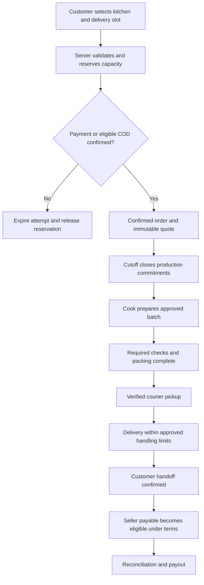

# Bety — بيتى
## Business model, complete product experience, operations, and launch plan

**Version:** 1.0  
**Prepared:** 27 October 2026  
**Market:** Egypt  
**Stage:** Founder planning and validation  
**Product language:** Arabic-first, with English support  
**Currency and business time:** EGP; Africa/Cairo

> **The business in one sentence:** Bety helps mothers and independent cooks build sustainable food businesses by connecting customers to clearly described home-style meals, with accountable kitchen approval, ordering, delivery, customer support, and settlement.

> **Recommended starting model:** A managed marketplace with scheduled preorders, one kitchen per order, a small approved menu, limited daily capacity, and one tightly defined delivery zone. Begin through legally approved production arrangements. Expand only when safety, repeat demand, cook earnings, and contribution margin support expansion.

### How to read this plan

This document is a concrete starting specification. Unless explicitly identified as an external fact, policies, prices, thresholds, budgets, staffing levels, and deadlines are **proposals to validate**, not observed market results or statutory requirements. Financial examples are illustrative planning calculations. They are not current supplier quotes or investment forecasts.

The founding idea is that many customers would value the taste, care, and familiarity of food made by mothers. That is a hypothesis to test through paid orders and repeat behavior. Home preparation alone does not prove better nutrition, safety, or quality than a restaurant. Bety must earn each claim through its actual standards and delivery experience.

Legal classification, kitchen permissions, taxes, consumer terms, worker arrangements, privacy permissions, and payment structure require qualified Egyptian review for the exact operating model. These are workstreams with owners and launch gates throughout the plan.

## Contents

1. [Vision and strategic choices](#1-vision-and-strategic-choices)
2. [Customer needs and validation](#2-customer-needs-and-validation)
3. [Market positioning and neighborhood selection](#3-market-positioning-and-neighborhood-selection)
4. [Business model and revenue](#4-business-model-and-revenue)
5. [Cook recruitment and onboarding](#5-cook-recruitment-and-onboarding)
6. [Kitchen profiles, meals, and menus](#6-kitchen-profiles-meals-and-menus)
7. [Complete customer experience](#7-complete-customer-experience)
8. [Complete cook experience](#8-complete-cook-experience)
9. [Delivery and admin experiences](#9-delivery-and-admin-experiences)
10. [Order lifecycle and source of truth](#10-order-lifecycle-and-source-of-truth)
11. [Capacity, cutoffs, and availability](#11-capacity-cutoffs-and-availability)
12. [Food safety and quality system](#12-food-safety-and-quality-system)
13. [Delivery operations](#13-delivery-operations)
14. [Payments, settlement, and cash control](#14-payments-settlement-and-cash-control)
15. [Cancellations, complaints, and refunds](#15-cancellations-complaints-and-refunds)
16. [Restrictions, enforcement, and fairness](#16-restrictions-enforcement-and-fairness)
17. [Egyptian legal and regulatory workstream](#17-egyptian-legal-and-regulatory-workstream)
18. [Economics, cash needs, and funding](#18-economics-cash-needs-and-funding)
19. [Acquisition, retention, and brand](#19-acquisition-retention-and-brand)
20. [Operating team and daily routines](#20-operating-team-and-daily-routines)
21. [MVP scope and later releases](#21-mvp-scope-and-later-releases)
22. [Technology, data, and security](#22-technology-data-and-security)
23. [Deployment and production readiness](#23-deployment-and-production-readiness)
24. [Roadmap and launch gates](#24-roadmap-and-launch-gates)
25. [Metrics and experiments](#25-metrics-and-experiments)
26. [Risk register and difficult scenarios](#26-risk-register-and-difficult-scenarios)
27. [Acceptance criteria and release checklist](#27-acceptance-criteria-and-release-checklist)
28. [Founder decisions and immediate actions](#28-founder-decisions-and-immediate-actions)
29. [Reusable operating templates](#29-reusable-operating-templates)
30. [Research sources and evidence limits](#30-research-sources-and-evidence-limits)

---

## 1. Vision and strategic choices

### 1.1 Mission

Make dependable home-style food easier to buy and make cooking income more accessible, predictable, and dignified for mothers and independent cooks.

The customer receives a meal with a named seller, an accurate portion, disclosed ingredients and allergens, a clear delivery promise, and a real support path. The cook receives access to demand, help with presentation and operations, transparent fees, and dependable payment. Bety earns revenue by making these outcomes work consistently.

### 1.2 Brand promise

**Suggested Arabic line:** «أكل بيتي من ناس تثق فيهم»  
**English meaning:** Home-style food from people you can trust.

Trust must have an observable meaning: identity checked, production eligibility reviewed, a defined assessment completed, menu information reviewed, and recent fulfillment performance available. Avoid an undefined badge saying “100% safe,” “government certified,” or “healthier than restaurants.”

Use **Bety — بيتى** consistently as the founder's proposed name. Validate spelling, trademark availability, Arabic search variants such as «بيتي», domains, and app-store naming before investing in a public brand identity. Do not claim those assets are available yet.

### 1.3 Product and operating decisions for the first release

1. Start in one neighborhood-sized service area chosen from research; do not launch all Cairo or all Egypt.
2. Recruit 8–12 founding cooks, with only 5–8 active at first and the others trained as backup. These are pilot design targets.
3. Use approved production premises. If a residential route cannot be confirmed, use an appropriately licensed shared kitchen while retaining the cook's identity and story.
4. Offer scheduled meals with an order cutoff and a specific delivery window.
5. Allow one cook and one fulfillment window per checkout.
6. Begin with 2–4 reviewed dishes per active cook; keep the combined daily catalog small enough for support and delivery to understand.
7. Sell fixed meals and fixed family portions. Add complicated bespoke requests only after operational validation.
8. Manage delivery through a contracted local partner or a controlled courier pool. Do not require a custom courier app for the first pilot.
9. Use a regulated payment arrangement with an approved marketplace money flow. Introduce tightly controlled cash on delivery only when reconciliation is ready.
10. Keep live human support available during every active fulfillment window.

### 1.4 What makes the product defensible

The app alone is easy to imitate. A stronger advantage develops from reliable neighborhood supply, repeat customers attached to specific cooks, verified recipe and batch histories, safe fulfillment, and delivery density.

Protect the relationship by being useful: predictable payments, fair dispute handling, repeat ordering, coordinated delivery, and business guidance. Do not rely on aggressive exclusivity or punitive rules to prevent cooks from leaving.

### 1.5 Social impact with commercial discipline

Measure cook income **after ingredients, packaging, utilities, waste, and labor**. More sales can make a cook worse off if the pricing is wrong. Help each cook understand the difference between revenue, cash received, contribution, and take-home income.

Mothers are the founding community, but a seller does not need to reveal family details or use motherhood as a sales story. Eligibility should follow objective adult-seller, food, legal, and conduct criteria reviewed with local counsel. Include qualified independent cooks without forcing personal identity narratives.

## 2. Customer needs and validation

### 2.1 Initial customer segments

**Working households:** Need a dependable dinner or lunch with familiar flavors and enough food for the household. Their strongest buying criteria are total price, portion size, trustworthy preparation, and predictable arrival.

**Busy individuals and young couples:** Want convenient meals without restaurant-style repetition. They may order smaller portions several times per week. Watch delivery cost relative to a small basket.

**Adult students and people living away from family:** Value familiar food, budget control, and consistency. Avoid targeting children or collecting unnecessary age-sensitive information.

**Small office groups:** Could improve order density through one destination and planned lunch windows. Test later with fixed menus and advance payment; office credit and invoicing introduce extra operations.

**Family gatherings:** Larger baskets may be attractive, but exact delivery time, batch capacity, deposits, and cancellation exposure are harder. Treat events as a later, separately designed service.

Prioritize working households in the first zone and test whether family portions produce a sustainable basket. Do not attempt to serve every segment with one workflow.

### 2.2 Cook problems to solve

- Reaching customers beyond friends and social groups.
- Answering repeated questions about availability, prices, portions, and delivery.
- Handling last-minute cancellations after buying ingredients.
- Scheduling cooking around family responsibilities.
- Receiving money and understanding deductions.
- Delivering food without sharing the home address widely.
- Photographing and describing meals accurately.
- Meeting practical safety and documentation requirements without confusing forms.

### 2.3 Interviews before development

Interview approximately 25 target households, 15 cooks, 3 delivery operators, and relevant legal, accounting, and food-safety professionals. These sample sizes support learning; they do not produce representative market statistics.

Ask customers about the last three meals they purchased: what they bought, how much the full order cost, where it came from, what failed, and whether they reordered. Ask to see actual past ordering behavior with consent. Avoid asking only whether they “like the idea.”

Ask cooks to cost a real recipe, including shopping and cleanup time. Review a typical day, oven and refrigeration limits, existing repeat customers, cancellation losses, and acceptable payout timing. Do not ask them to reveal customer contact lists without those customers' permission.

### 2.4 Hypotheses and decision thresholds

Proposed discovery thresholds:

- At least 10 of 25 households commit to a specific paid trial at a displayed total price and delivery window.
- At least 5 cooks can demonstrate production eligibility, workable costs, willingness to follow standards, and available capacity.
- A courier can complete measured trial routes inside the approved thermal and service limits.
- At least 30 households complete paid pilot orders through approved kitchens before a large app build is funded.
- A meaningful share reorders without a larger discount; measure exact cohort results rather than declaring success from signups.

If customers like the concept but will not pay the fully loaded price, revise the basket, portion, service zone, or model before expanding development.

### 2.5 Concierge pilot

Once the legal and safety gates are met, run a short concierge pilot with a simple catalog, secure checkout, and an internal order board. Staff may assist customers by phone or an approved business messaging channel, but every order must enter the same system of record with consent, pricing, and fulfillment details.

Do not operate food sales as an “informal test” to bypass approvals. Unpaid interviews and non-food prototypes can proceed while permissions are resolved. Paid meals require the chosen legal route first.

## 3. Market positioning and neighborhood selection

### 3.1 Positioning

Bety competes for the customer's meal budget against restaurant delivery, direct orders from home cooks, daily cooking, prepared supermarket food, and meal subscriptions.

The proposed position is **familiar meals, a visible cook, clear portions, and reliable scheduled service**. It should not promise the cheapest price, instant arrival, or superior safety solely because the cook is a mother.

Before launch, compare current local alternatives using test purchases in the intended zone. Record meal subtotal, all fees, portion size, delivery reliability, packaging, support, and reorder convenience. Do not infer nationwide competition from one neighborhood or use unverified competitor statistics in investor material.

### 3.2 How to choose the first zone

Shortlist compact areas where the founder can be physically present and where supply and demand overlap. Examples to investigate could include a bounded part of Maadi, Nasr City, New Cairo, or another city the founder knows; these are research options, not validated recommendations.

Score each candidate from 1–5 on:

- Concentration of target households within actual road travel distance.
- Number of cooks with feasible approved premises.
- Ability to deliver a warm meal within tested thermal limits.
- Courier availability and cost at lunch and dinner.
- Building access, gate delays, traffic, and parking.
- Existing community relationships and permission-based acquisition channels.
- Customer willingness to pay the full basket price.
- Availability of backup cooks and production continuity.

Weight legal feasibility and safe delivery as hard gates. A high score on demand cannot compensate for either failing.

### 3.3 Service boundary

Use a delivery polygon based on measured road routes. A proposed first radius of roughly 2–4 km is only a planning starting point. Bridges, traffic, weather, and access delays may make a smaller area necessary.

At address entry, clearly show whether the customer is inside the zone. Outside-zone customers can join a consent-based waitlist; they must not complete a checkout that operations cannot fulfill.

### 3.4 Bottom-up market sizing

Build a zone model from reachable households, qualified demand, achievable order frequency, available cook capacity, and actual courier throughput.

```text
Demand orders/month = reachable households × active buying share × orders per buyer
Supply orders/month = active cooks × sellable portions/day × operating days ÷ portions/order
Delivery orders/month = deliverable orders/window × windows/day × operating days
Achievable orders = minimum(demand, supply, delivery)
Food GMV = achievable completed orders × average food subtotal
```

For illustration only, 3,000 reachable households × 10% active × 3 orders/month = 900 orders/month. Six cooks × 15 portions/day × 22 days ÷ 2 portions/order = 990 orders/month of supply. Delivery still needs to support 900 orders. These assumptions are a validation model, not a measured opportunity or forecast.

## 4. Business model and revenue

### 4.1 Recommended structure

Bety operates a managed marketplace: the approved food seller prepares the meal; Bety supplies the ordering experience, marketplace standards, customer service, and delivery coordination. Contracts and checkout must clearly identify the food seller and Bety's responsibilities.

The exact principal-versus-agent and merchant-of-record treatment must be agreed with counsel, the accountant, and the payment partner. Calling the company a “platform” does not remove consumer, food, privacy, or payment obligations.

If Bety operates a shared kitchen, employs cooks, buys ingredients, or sells meals in its own name, the model changes. Recalculate responsibilities, insurance, licenses, labor costs, revenue recognition, and unit economics before using that route.

### 4.2 First revenue streams

**Food commission:** Test a proposed 15–22% of the defined food sales base; use 20% in the illustrative model. Publish the basis, tax treatment, promotion treatment, and refund reversal policy. Obtain a real seller acceptance rate before fixing a launch rate.

**Delivery charge:** Quote the customer's delivery fee separately. The difference between customer fee and courier cost may be negative. Track that explicitly.

**Service fee:** Test a small transparent fee only if customers accept the total. The model uses EGP 10 as an assumption. Avoid a headline price that hides mandatory charges until the last step.

Basic onboarding should not require a large listing payment from cooks. The business should earn when real orders are fulfilled. Training equipment can be subsidized, loaned, or sold at disclosed cost with fair written terms.

### 4.3 Later revenue options

- Planned weekly meal bundles after retention and capacity are proven.
- Office group orders with tested fulfillment and payment terms.
- Optional packaging procurement at a disclosed margin.
- Optional professional photography or business support.
- Clearly labeled sponsored placement after organic ranking is trusted.

Do not depend on advertising, financial products, cook loans, a stored-value wallet, or selling personal data to make the early business work.

### 4.4 Commercial responsibilities

The cook approves the menu, portion, ingredient information, capacity, and price within marketplace rules. Bety may flag uneconomic prices and inaccurate descriptions, but must not silently lower a cook's net proceeds.

Bety owns the customer-facing order record and resolution process. Courier and cook liability allocation is handled afterward from evidence and contract terms. The customer should not have to negotiate among three parties to resolve a failed order.

### 4.5 Commercial rules that must be visible

- Exact commission base, deductions, and applicable taxes.
- Who pays for packaging and delivery subsidies.
- Who funds each promotion.
- Payout schedule and dispute handling.
- Cancellation and replacement rules.
- Required operational standards and grounds for suspension.
- Whether any commercial exclusivity exists; start without broad exclusivity.

## 5. Cook recruitment and onboarding

### 5.1 Recruitment approach

Recruit through trusted local networks, referrals, community groups with permission, and organizations supporting women entrepreneurs. Lead with the actual proposition: support with orders, delivery, standards, and payments. Do not promise a guaranteed income or full-time demand.

Offer assisted onboarding in Egyptian Arabic. A field coordinator should be able to guide a cook through a short form and explain requirements verbally, while still collecting explicit agreement to the written terms.

### 5.2 Onboarding stages

```text
Interested → Application → Identity review → Production eligibility review
→ Kitchen assessment → Training → Menu and costing review → Trial fulfillment
→ Commercial agreement → Payout verification → Approved with capacity limit
```

Each step has a status, owner, reason code, evidence, date, and next action. Application approval does not automatically publish a kitchen. A cook may pass identity review and fail production eligibility.

### 5.3 Information to collect

- Adult seller identity and verified phone number through a proportionate process.
- Legal seller name, trading name, and eligible business or tax information as advised.
- Exact approved production address, accessible only to authorized staff and assigned couriers.
- Preferred public display name and optional story, photo, or voice introduction.
- Type of premises, permitted activity, documented permissions, and expiry dates.
- Food-handling credentials or health documentation where required.
- Equipment, reliable water, refrigeration, preparation and storage arrangements.
- Ingredient procurement practices, allergen environment, and categories of meals.
- Realistic cooking days, batch sizes, and available pickup windows.
- Verified bank or approved payout details; avoid unnecessary storage of financial identity documents.
- Emergency operational contact, with that person's agreement if collected.

Do not collect family member IDs, details about children, marital status, religion, or photographs of private living areas unrelated to the assessment.

### 5.4 Kitchen assessment

A qualified food-safety assessor uses a documented checklist and evaluates the actual approved cooking location. A short video or attractive food photo cannot replace this assessment.

Review cleaning, pests, waste, potable water, storage, raw/cooked separation, equipment condition, handwashing, thermometer use, temperature control, packaging, allergen controls, power interruption planning, and transport handoff. Assess safe practical capacity rather than accepting a self-declared maximum.

Use three outcomes: **approved within conditions**, **remediation required**, or **rejected for this production route**. Provide the cook with understandable reasons, corrective steps, and a review path.

### 5.5 Trial and probation

Complete a small controlled trial using the actual menu, portions, packaging, timing, labeling, and courier handoff. Check food-safety records separately from sensory quality.

For the first 10–20 fulfilled orders, apply a conservative capacity cap and enhanced support. Increase capacity only after reviewing readiness, packing mistakes, customer feedback, batch records, and cook workload. The number is a proposed operational rule, not a certification standard.

### 5.6 Expiry and recurring review

Store document validity periods and send reminders. When a required approval expires, stop new sales for affected future production dates, flag committed orders, and let operations determine a safe lawful resolution. Never leave those orders silently active.

Reassess after a location change, major equipment failure, serious complaint, category expansion, or significant capacity increase. Apply periodic reviews determined by risk and professional guidance.

## 6. Kitchen profiles, meals, and menus

### 6.1 How a mother or cook appears to customers

The public kitchen page should include:

- Public kitchen name, such as «مطبخ أم مريم» only with the cook's consent.
- Optional approved portrait and short personal introduction.
- Neighborhood or service area, without the private home pin.
- Specialties and cooking style.
- Available days, next order cutoff, and next delivery windows.
- Meaning and date of Bety's actual review badge.
- Verified-order rating with count and recent performance context.
- Clear ingredient/allergen information and the kitchen's cross-contact limitations.
- Current dishes, prices, portion sizes, and stock for the selected date.
- Seller identification and contact disclosures required by the approved legal model, designed with privacy advice.

Show a precise badge such as “Bety assessment completed · September 2026” only when true. A platform assessment must not be displayed as an official government certification.

### 6.2 Meal information

Every sellable meal needs:

- Stable meal ID, recipe version, category, and public name.
- Real representative photo with consent and ownership rights.
- Exact included components: for example, protein quantity, rice quantity, and sides.
- Portion measure and approximate serving guidance based on an actual measured sample.
- Ingredients, declared allergens, and relevant cross-contact disclosures.
- Fixed options such as spice level where the kitchen can fulfill them safely.
- Price, optional extras, minimum quantity, and availability for the selected slot.
- Preparation date, storage/reheating instructions, and use-by guidance approved for that recipe and process.
- Packaging type and whether cutlery is included or optional.
- Cutoff and cancellation rules available before payment.

Do not publish unverified calorie counts, “diabetic safe,” “allergy safe,” “organic,” or medical benefit claims. If nutritional estimates are introduced later, define the method, uncertainty, review, and recipe-change controls.

### 6.3 Menu publishing workflow

```text
Draft meal → Ingredient and allergen review → Cost and portion review
→ Food-safety category approval → Photo/content review → Published for slots
```

A price, ingredient, portion, or allergen change creates a new version. Existing orders retain their accepted version. If the change is safety-related, stop sales and review every affected order; retaining the old snapshot is not permission to fulfill unsafe food.

### 6.4 Initial meal categories

Start with fully cooked Egyptian meals that hold and travel well under a validated process, such as selected stews, rice dishes, vegetable dishes, and approved protein combinations. Approve each recipe and handling process individually.

Even familiar foods such as rice and poultry can create hazards when cooling, holding, or reheating is poor. “Traditional” is not a safety category.

Exclude high-complexity and higher-risk products from the initial catalog, as detailed in Section 16. Do not add a dish solely because customers request it frequently.

### 6.5 Example of a public kitchen card

The following is fictional UX copy for a kitchen that has actually passed the required reviews; it is not a real seller listing:

```text
مطبخ أم مريم
أكل مصري بيتي · منطقة الخدمة: المعادي

عن المطبخ:
وجبات يومية بطعم البيت، بكميات واضحة ومنيو بيتغير كل أسبوع.

موعد التوصيل المتاح: بكرة من ١ لـ٢ ظهرًا
آخر موعد للطلب: النهارده الساعة ٩ مساءً

اعرف تفاصيل مراجعة المطبخ ومعاييرها
شوف الوجبات والمكونات ومعلومات الحساسية
```

Only display real review dates, authentic verified-order ratings, actual availability, and the seller disclosures required for that kitchen. Let the cook choose a different public name and omit a portrait. The exact home address does not appear in this discovery card.

## 7. Complete customer experience

### 7.1 Entry, location, and language

Allow browsing before account creation. Ask for neighborhood or an address to determine serviceability, explain why it is needed, and support manual address entry without forcing location permission.

Use Egyptian Arabic first, with an English switch. Phone OTP is a practical proposed sign-in method, with rate limits, accessible resend behavior, and a support fallback. Do not expose whether a phone number belongs to another user.

Address fields should support map pin, building number, floor, apartment, landmark, and optional access instructions. Confirm the pin and written address together. Keep sensitive access notes out of general analytics and public reviews.

### 7.2 Home and discovery

The home screen first answers: **What can arrive at my address, on what day, and in which window?**

Show date/window selection, available meals, kitchens, final-fee estimates, saved cooks, and an easy reorder entry. Distinguish “available today” from “order today for tomorrow.” If the cutoff has passed, show the next valid window.

Useful filters: meal category, portion size, price, vegetarian ingredients, spice level, cook, and delivery date. Allergen information needs explicit review; a filter must not imply a guarantee against cross-contact.

Rank kitchens by eligibility and availability first, then relevance, fulfillment reliability, verified feedback, and diversity of exposure. Give new approved cooks a measured opportunity. Do not rank solely by paid placement or raw sales volume.

### 7.3 Kitchen page and meal page

The customer can read the cook's story, review the badge meaning, inspect portions and ingredients, and choose a valid quantity. Photos should show what actually arrives in packaging, not only a styled family table.

Show the portion unit clearly: one individual meal, a tray for approximately two adults, or a measured weight. “Family size” alone is too vague.

Use structured options for requests the cook supports. Free-text notes must state that they cannot change ingredients, allergens, portions, or preparation commitments. Direct customers with serious allergy needs to the published kitchen limitations; do not route safety-critical requests through casual chat.

### 7.4 Cart

One cart contains meals from one kitchen for one delivery slot. Adding another kitchen offers a clear choice to replace the cart or save it for later. Do not silently split the order or add a second delivery fee.

Show quantities, food subtotal, packaging if separately charged, delivery, service fee, discounts by sponsor, applicable tax treatment, and final amount due. Clearly disclose the cancellation cutoff and delivery window.

Stock and prices are provisional until checkout validation. If something changed, explain exactly what changed and ask the customer to accept the new quote before charging.

### 7.5 Checkout and confirmation

1. Confirm customer phone and delivery address.
2. Confirm date, delivery window, meal version, quantities, and supported options.
3. Display ingredients/allergen information with a meaningful acknowledgment where appropriate; a checkbox never waives legal rights or cures inadequate controls.
4. Display the full price, named seller, policy links, and payment method.
5. Atomically reserve inventory and slot capacity for a short displayed payment period.
6. Create the payment attempt through the approved provider flow.
7. Confirm only when the server verifies the payment or an eligible COD commitment.
8. Send an order number, receipt, cutoff, delivery window, and support entry.

The confirmation must say either “confirmed” or “payment still being checked.” A customer returning from a payment page is not sufficient evidence of payment success.

### 7.6 Before preparation

The order detail shows the scheduled date, accepted meal information, current status, cancellation eligibility, and support. Before the cutoff, an eligible cancellation is straightforward and displays the refund amount and expected process.

Changing quantity, kitchen, date, or address after confirmation requires a server-side recheck. In the MVP, use cancellation/reorder before the cutoff for material changes; after it, support handles exceptions. Never overwrite a paid order total without a corresponding approved payment adjustment.

### 7.7 Preparation and delivery

Show a simple progress sequence: confirmed, preparing, ready, courier collected, arriving, delivered. Customer copy should reflect actual recorded events.

If a delay threatens the window, notify the customer proactively with a realistic revised estimate and resolution options. When live courier location is unavailable, show an honest status and last update time.

Offer masked communication where supported. Do not reveal the cook's private phone or household location. The courier sees only the details needed for the assigned job.

### 7.8 Delivery completion

Use a delivery PIN or another proportionate proof of handoff. The courier requests the code at handoff, not before leaving the kitchen. Support can use an audited alternate completion path when the customer's phone fails.

Default to handing food to the customer. Unattended delivery requires a specifically approved process compatible with food safety and the customer's instructions; the MVP should avoid it.

### 7.9 After the meal

Allow separate feedback for taste/portion, packaging, and delivery, plus private safety reporting. A late courier should not automatically damage a cook's food rating.

Ask for reviews only after fulfilled orders. Hide phone numbers, home addresses, and abusive content from public reviews through documented moderation. Never buy positive reviews or remove fair criticism to improve conversion.

Offer a one-tap reorder that revalidates menu version, stock, price, date, and serviceability. Favoriting a cook should make repeat ordering easier without creating a recurring financial commitment.

### 7.10 Key customer screens

Welcome/language; service area; home/date selection; search/filter; kitchen profile; meal detail; cart; address book; checkout; payment pending/result; order detail/tracking; order history/reorder; support case; refund status; favorites; account/privacy controls.

For every screen, design loading, empty, offline, validation, unauthorized, and stale-data states. Preserve an interrupted cart locally, but revalidate all commercial and safety conditions on the server.

### 7.11 One complete example order

On Monday evening, a customer chooses an address inside the pilot zone, selects Tuesday's 13:00–14:00 delivery window, and opens an approved cook's menu. She selects two portions with an illustrative combined food subtotal of EGP 350. The quote shows EGP 35 delivery, EGP 10 service, and any applicable tax adjustment before she pays.

The server reserves the two portions, validates payment, and confirms the order before Monday's 21:00 cutoff. The cook's Tuesday production board gains two committed portions. The customer sees the accepted meal description, cancellation deadline, receipt, and delivery window.

On Tuesday, the cook follows the approved process, completes required batch/packing checks, and hands the sealed packages to the assigned courier. The courier completes a verified handoff within the promised window and the validated handling limits. The customer can rate the meal and delivery separately or report an issue.

The cook's statement shows EGP 350 food sales, EGP 70 commission at the illustrative 20% rate, and EGP 280 seller proceeds before any applicable seller-specific tax or valid adjustment. Finance reconciles the order and includes the eligible payable in the published payout cycle. If any stage fails, the relevant exception rules apply without erasing the order history.

## 8. Complete cook experience

### 8.1 Design principles

Use large controls, plain Egyptian Arabic, few fields per step, clear money explanations, and optional audio guidance. Support lower-cost Android phones and unstable connections. A cook should not need spreadsheet skills to know what to prepare or what she will receive.

### 8.2 Today screen

The cook sees today's operating status, production location, pickup windows, orders by batch, portions by dish, required labels/checks, unresolved alerts, and expected net payout. Keep “sales,” “deductions,” “pending,” and “paid” distinct.

The main actions are: review tomorrow's plan, adjust future capacity, start preparation, record required batch checks, mark ready, verify courier pickup, and contact support.

### 8.3 Availability and menu planning

The cook chooses working days and quantities before opening sales. A pause stops new orders and clearly lists existing commitments that still need action.

Capacity can increase only within the approved maximum and available courier capacity. Reducing availability below confirmed commitments creates an operations incident; it does not cancel customers invisibly.

An optional assisted menu service can help with descriptions and photos, but publication still requires the cook's confirmation of ingredients, portion, price, and capacity.

### 8.4 Order management

For the MVP, published inventory is a commitment: valid orders auto-confirm up to the limit after successful payment/COD validation. This avoids a customer paying and waiting indefinitely for acceptance.

If later allowing manual acceptance for custom requests, create a separate unpaid or provider-authorized flow with an explicit expiry. Do not mix it with the standard confirmed-order promise.

Show each order's portion counts, supported options, pickup window, batch, package count, and limited necessary customer instructions. The cook generally does not need the customer's exact apartment address for platform delivery.

### 8.5 Preparation board

Aggregate portions by dish and recipe version. Print or display labels tied to order and batch IDs. Provide a sequence for ingredient readiness, required temperature/handling checks, packing, and handoff.

Offline notes may be queued, but the app must visibly mark unsynced actions. An unsynced “ready” tap must not dispatch a courier as if the server received it. Give support a reliable phone fallback that records the action centrally.

### 8.6 Earnings and payout screen

For each order show food sales, discount sponsor, commission base and amount, taxes/withholding where applicable, approved adjustments, and net seller payable. For each payout show included orders, held/disputed items, bank/provider reference, and status.

Avoid calling this an unrestricted “wallet.” It is a ledger view of seller receivables. It does not offer top-ups, transfers between users, or payment services unless separately designed and legally approved.

### 8.7 Support, development, and wellbeing

Provide easy issue categories: ingredient shortage, illness, power failure, courier delay, wrong quantity, payout question, harassment, and emergency stop.

A cook can report illness without being pressured to prepare food. Plan backup supply and fair failure allocation. Coaching should focus on measurable improvements and workload, not shame or public penalties.

### 8.8 Key cook screens

Application/status; documents and review; training; kitchen profile; meal drafts/review; calendar/capacity; today/production batches; order detail; safety/packing checklist; courier handoff; earnings; payout detail; support/appeal; pause and emergency stop.

## 9. Delivery and admin experiences

### 9.1 Courier experience

Start with the partner's delivery tool or a secure mobile job page. The courier sees assigned jobs, pickup window, verified pickup address when needed, sealed package count, handling requirements, destination, customer contact relay, COD amount if relevant, and completion actions.

At pickup, the courier confirms assignment, checks package identifiers and seal condition, records required handoff observations, and confirms custody. The cook verifies the courier or pickup code. A courier cannot claim an arbitrary kitchen's orders.

The courier does not edit meal contents, collect extra fees, open food packages, reuse customer information, or mark an undelivered order delivered to close a route.

### 9.2 Admin workspace

Required admin modules:

- **Live operations:** Orders grouped by slot, kitchen readiness, dispatch state, risk of delay, and available capacity.
- **Cook onboarding:** Applications, evidence, assessment outcomes, remediation, approval expiry, and capacity approvals.
- **Catalog:** Meal versions, ingredients/allergens, photos, category restrictions, prices, and publication history.
- **Delivery:** Courier assignment, pickup delay, route exceptions, failed handoff, and partner incidents.
- **Support:** Order-linked cases, complaint classification, customer communication, SLA timers, and evidence.
- **Safety:** Batch lookup, kitchen stop-sale, contact lists for affected orders, incident chronology, and controlled reopening.
- **Finance:** Payment attempts, refunds, chargebacks, cash reconciliation, commissions, seller payables, and payout runs.
- **Commercial configuration:** Zones, slots, fees, promotion funding, cancellation policies, and effective dates.
- **Analytics:** Cohorts, contribution, seller earnings, failures, and zone density.
- **Access and audit:** Role permissions, privileged changes, access logs, and export controls.

### 9.3 Permissions and high-impact actions

Customer support may inspect assigned order details and grant small refunds within a documented limit. It should not modify payout bank accounts, kitchen eligibility, or payment records.

Food-safety staff may stop sales immediately. Reopening after a serious safety incident requires documented corrective action and a second authorized reviewer.

Finance prepares payouts; a separate approver releases them where staffing permits. During a tiny pilot, use a daily founder review and documented reconciliation to compensate for limited role separation.

Changing payout details requires identity re-verification, a notification through an existing trusted channel, an approved cooling period, and additional review for the first payout. Never trust a bank-change request only because it arrives in a message.

### 9.4 Customer-facing communication examples

- Scheduled order: «اطلب لحد ٩ بالليل، والتوصيل بكرة من ١ لـ٢ ظهرًا».
- Cutoff passed: «ميعاد طلبات النهارده خلص. تقدر تختار أقرب ميعاد متاح».
- Fee transparency: «شوف إجمالي الطلب والتوصيل قبل ما تأكد».
- Cook pause: «وقفنا الطلبات الجديدة. عندك طلبات مؤكدة محتاجة متابعة».
- Delay: «طلبك متأخر عن الميعاد المتوقع. فريقنا بيتابع، وهنوضح لك الاختيارات المتاحة».
- Safety report: «لو في مشكلة في سلامة الأكل، وقف تناوله وبلّغنا فورًا».

Final Arabic copy needs a native Egyptian review, RTL testing, accessible numbers, and consistency between customer, cook, support, and legal wording.

## 10. Order lifecycle and source of truth

### 10.1 Separate business states

Do not place every concept in one status field. Maintain related but separate records:

- **Order:** Draft/quoted, awaiting payment, confirmed, fulfillment active, completed, canceled, or failed.
- **Payment attempt:** Created, pending, authorized where supported, captured, failed, or expired.
- **Refund:** Requested, approved, submitted, succeeded, or failed; partial and full amounts recorded separately.
- **Fulfillment:** Scheduled, preparing, ready, assigned, collected, delivered, or delivery failed.
- **Seller settlement:** Not eligible, eligible, held with reason, scheduled, paid, or reversed/adjusted.
- **Support/safety case:** Open, investigating, actioned, resolved, or reopened.

An order can be delivered and later partially refunded. It remains a delivered order with an associated refund, rather than losing its fulfillment history. A customer refund does not automatically prove cook fault or automatically authorize a seller deduction.

### 10.2 Normal scheduled order



### 10.3 Ownership of transitions

- The server creates quotes, expires reservations, validates payments, and confirms orders.
- The cook starts preparation and records readiness against assigned orders/batches.
- Operations assigns or changes a courier and handles schedule exceptions.
- The assigned courier records collection and customer handoff.
- Support handles cancellation requests and documented completion corrections within permission limits.
- Safety staff can quarantine a batch or stop a kitchen at any stage.
- Finance manages reconciled payables and payout approval.

Every transition requires authorization, permitted prior state, server time, actor, reason where relevant, and an audit event. Important transitions use optimistic concurrency or transactional locking to prevent two actors producing contradictory outcomes.

### 10.4 Required invariants

1. A confirmed order must have an eligible seller, approved meal version, valid capacity, accepted quote, and a verified payment/COD commitment.
2. Confirmed quantities cannot exceed sellable portions or the slot's safe production and delivery limits.
3. A payment attempt, refund request, or payout cannot be applied twice.
4. A canceled order cannot enter preparation without an explicitly reviewed correction; no silent reactivation.
5. Collected or delivered food cannot return to sellable stock.
6. A quarantined batch cannot be handed over merely because a courier arrived.
7. A full customer refund does not delete the original invoice or ledger history.
8. A payout cannot include the same seller payable twice.
9. Client taps and push notifications are requests or information, not authoritative financial events.

### 10.5 Important recovery behavior

**Payment success arrives after reservation expiry:** Recheck stock, slot, cutoff, eligibility, and amount transactionally. If still valid, confirm once. Otherwise void/refund through the provider and tell the customer the order was not accepted. Do not oversell to accommodate a late webhook.

**Customer taps pay twice:** Reuse an order-scoped idempotency key and return the existing attempt/outcome. Never create two independent charges for one accepted quote.

**Courier changes:** Revoke old assignment access and pickup token; publish the new assignment to cook and customer as relevant. Preserve custody records.

**App closes during checkout:** Customer can retrieve the server-side order/payment status. Do not tell them to pay again while the first attempt remains uncertain.

**No connectivity during handoff:** Use an approved support procedure, record actual handoff time and actor, then reconcile the event. Do not fabricate a GPS trail or automatically mark delivery.

## 11. Capacity, cutoffs, and availability

### 11.1 Capacity is more than dish stock

Track capacity at four levels: meal portions per date, shared production resources, kitchen pickup window, and delivery window/zone. Two dishes using the same oven cannot each independently consume its full capacity.

For the first release, a simple conservative combined kitchen portion cap is acceptable. Use more detailed resource planning only when evidence shows that it is needed.

```text
Sellable portions = approved daily limit − confirmed portions − unexpired reservations
Order eligibility = kitchen eligible AND meal approved AND date open
                    AND address serviceable AND before cutoff
                    AND all portion/kitchen/delivery limits available
```

Reservations use database transactions as the final control. Redis can accelerate availability but must not be the only record preventing overselling.

### 11.2 Proposed pilot schedule

For an example lunch service:

- Publish the next day's reviewed menu by the afternoon.
- Close customer preorders at 21:00 on the previous day.
- Freeze confirmed production quantities after cutoff and resolve payment uncertainty.
- Prepare the following morning according to the approved recipe/process.
- Plan packing and courier pickup backward from a 13:00–14:00 delivery window.
- Do not add “extra” lunch orders after the cutoff unless a separate approved, already-safe supply allocation and delivery capacity exist.

These times are proposed business rules. Thermal limits come from the food-safety process, not from the marketing delivery window. A one-hour delivery window does not authorize food to remain outside required temperature control for that hour.

### 11.3 Cutoff, prep lock, and payment reservation

Store explicit fields such as `order_cutoff_at`, `free_cancel_until`, `planned_prep_start_at`, `pickup_window`, `delivery_window`, and `reservation_expires_at`.

Use a proposed 10-minute payment reservation, shortened when the ordering cutoff is closer. The UI displays a countdown derived from server time. Reservation expiry releases quantities once. A confirmed order moves reserved quantities into committed quantities in the same transaction.

The server must reject new commitments after cutoff even when the client clock is wrong. Use `Africa/Cairo` for business date interpretation and test daylight-saving changes; never hardcode a constant UTC offset.

### 11.4 Pauses, shortages, and capacity changes

A cook can pause a future date without affecting confirmed orders on other dates. A kitchen emergency pauses all affected sales immediately and generates a list of committed orders.

Ingredient shortages require a documented decision: an equivalent approved option with customer consent and price correction, or cancellation/refund. Never silently replace chicken with another protein or change an allergen-bearing ingredient.

If the cook makes extra safe portions, they are not automatically listed. Operations must confirm recipe/batch validity, remaining holding life, and delivery capacity first.

### 11.5 Inventory release policy

Before preparation and before the slot cutoff, a confirmed cancellation may return unused ingredient/portion capacity to sale if safe and operationally valid. After production is committed, operations decides whether any unprepared capacity can be reused.

Prepared food, returned food, failed-delivery food, or food with uncertain custody never automatically returns to inventory. Safety controls override the desire to recover revenue.

## 12. Food safety and quality system

### 12.1 Foundation and accountability

Appoint a qualified food-safety lead to design and approve documented good hygiene practices and a hazard-based control plan covering procurement through customer handoff. The appropriate formal system and evidence depend on the activity, premises, and regulator's requirements.

The WHO framework covers cleanliness, separation of raw and prepared food, adequate cooking, temperature control, and suitable water and ingredients. Its training guidance identifies below 5°C for cold holding, above 60°C for hot holding, and avoiding more than two hours at room temperature. These are educational baselines, not a complete Egyptian commercial food standard or a validated delivery process. [WHO Five Keys manual](https://www.who.int/publications/i/item/9789241594639), [WHO manual PDF](https://iris.who.int/bitstream/handle/10665/43546/9789241594639_eng.pdf?sequence=1).

Bety's food-safety lead must establish product-specific cooking, holding, cooling, reheating, transport, shelf-life, measurement, and corrective-action limits. Apply stricter applicable requirements and validate them in real operating conditions. Do not use the general two-hour guidance as a delivery target or permission to ignore cold/hot control.

### 12.2 Launch blockers

Do not activate a kitchen without:

- Confirmed legal production route and required current approvals.
- Passed assessment and documented remediation of critical findings.
- Approved recipes, ingredients, allergens, portion standards, and suppliers/processes.
- Working appropriate refrigeration/hot holding and calibrated measurement equipment.
- Safe water, cleaning and sanitizing arrangements, pest prevention, and waste handling.
- Effective separation of raw ingredients, cooked food, chemicals, and personal items.
- A trained responsible food handler and an illness reporting procedure.
- Suitable food-contact packaging, labels, and a traceable handoff process.
- A validated delivery method and corrective actions for temperature/time failures.
- An incident contact and stop-sale capability that staff have practiced.

### 12.3 Daily controls

**Before production:** Confirm staff fitness to handle food, cleaning, water and power availability, equipment readings, ingredients and expiry, supplier/batch details, and planned quantities.

**During production:** Follow the approved recipe/process, prevent raw/cooked cross-contamination, record critical checks, use suitable cleaned probes, and avoid concurrent household activities that compromise the controlled production area.

**Before dispatch:** Confirm recipe/batch, package count, seal condition, labels, appropriate temperature/holding status, courier readiness, and remaining safe transport allowance.

**After service:** Record unsold/failed items and disposition, reconcile batches, clean and sanitize, review deviations, and close corrective actions before the next service.

The exact readings, sampling frequency, and measurement method are signed off by the safety lead. A checkbox saying “temperature OK” without a defined measurement and limit is inadequate.

### 12.4 Traceability

Each production batch should connect:

```text
Supplier/ingredient lot → kitchen + approved location → recipe version
→ production batch + relevant checks → packed items → orders
→ courier custody → customer handoff → complaints/withdrawals
```

Record who prepared and checked the batch, production and packing times, required critical-control observations, and any deviations. Retention periods must meet applicable requirements and the approved risk/insurance policy; do not invent a universal number of months.

The admin tool must retrieve all orders from an affected batch quickly, including pending, delivered, canceled, and refunded orders. A refund does not remove a person from a safety contact list.

### 12.5 Allergen policy

Maintain structured ingredient and allergen declarations for each recipe version and a kitchen-level cross-contact assessment. Train cooks on ingredient changes, shared oil/equipment, utensils, cleaning, and packaged ingredient labels.

Do not claim a dish is free of an allergen based only on omission from the recipe. If Bety cannot substantiate safe production for a particular allergy, state that clearly before purchase and do not accept an unsupported promise through notes or chat.

For a safety-critical customer question, either provide approved factual information or decline the request. Do not let an AI assistant, support agent, or courier improvise dietary safety assurances.

### 12.6 Packaging and labels

Use appropriate food-contact packaging suited to temperature, leakage, transport, and intended reheating. Validate supplier suitability. Do not suggest microwaving a container unless that use is approved.

Labels should include the required seller/product information plus order ID, kitchen, meal/recipe version or identifier, batch reference, production/packing information, relevant allergen notice, storage and consumption guidance, and support access. Exact mandatory labeling is a legal review item.

Keep hot and cold items separated using appropriate equipment. Seal packages so tampering can be detected; a seal supports custody checks and does not establish microbial safety.

### 12.7 Power, water, and equipment failure

Stop affected production/sales, identify food and orders at risk, preserve actual measurements and time records, and ask the safety lead to assess disposition. If safe conditions cannot be demonstrated, do not dispatch.

Do not rely on a cook tasting or smelling food to clear it. Do not tell staff to “reheat it and send it” after an unknown holding deviation. Offer cancellation/refund or an eligible replacement with customer agreement.

### 12.8 Suspected illness, contamination, or undeclared allergen

Treat one credible serious report as enough to trigger triage; do not wait for a cluster or a low star rating.

1. Advise the customer to stop consuming the suspect food. If urgent symptoms are reported, encourage prompt medical assistance; support must not diagnose or prescribe.
2. Escalate immediately to the designated safety lead and duty manager.
3. Quarantine the affected batch and pause relevant new sales/dispatches while scope is assessed.
4. Identify related ingredients, batches, kitchens, couriers, and customers using traceability records.
5. Contact affected customers with approved factual instructions through authorized operational channels.
6. Preserve evidence and logs securely. Arrange any sampling or testing through qualified personnel using an appropriate process.
7. Obtain professional direction on withdrawal/recall and regulator notification; do not delay a required notification while waiting for certainty or a test result.
8. Process appropriate customer remedies promptly, without requiring them to withdraw their complaint.
9. Document root cause, corrective actions, and independent review before reopening.

The legal and safety team must document actual reporting channels, deadlines, and authority obligations before launch. Proposed internal response goals are in Section 20 and do not replace legal deadlines.

### 12.9 Quality beyond safety

Set measured portion standards, packaging samples, recipe consistency checks, photo accuracy rules, and a periodic taste/texture review. Separate unsafe food from ordinary preference complaints, while handling both respectfully.

Track actual portion variance, missing components, leakage, overcooking, and transport deterioration. A five-star taste score cannot compensate for a critical safety failure.

## 13. Delivery operations

### 13.1 Pilot model

Use a small contracted delivery partner or an accountable courier pool trained for food handling. Obtain real quotes and check permissions, worker classification, insurance, equipment, cash handling, data access, and service commitments.

Do not assume ordinary parcel delivery is suitable for prepared food. Validate equipment and route performance under representative traffic and hot-weather conditions.

### 13.2 Scheduling and dispatch

Forecast delivery capacity before opening the slot. Plan courier arrivals around actual kitchen readiness and approved thermal controls. Dispatch software should not optimize distance at the expense of safe holding and handling.

Use a conservative limit for orders per courier route, determined through trials. Begin with simple direct deliveries or a small approved batch from one kitchen. Exclude multi-kitchen collection from the MVP.

### 13.3 Pickup protocol

- Confirm assigned courier and pickup token.
- Match order IDs, package count, and destination grouping.
- Check seals and visible leakage without opening food.
- Record required handoff checks and time.
- Use appropriate hot/cold transport equipment.
- Transfer custody centrally and notify the customer.

If a courier arrives before food is safely ready, operations manages the wait or reassignment. Do not mark ready to avoid a courier charge.

### 13.4 Delivery protocol

Protect packages from contamination, direct heat, tipping, and incompatible loads. Follow the validated route and handling limits. No unauthorized stops or handing packages to another courier without a recorded custody transfer.

At destination, verify customer/order, complete handoff, collect only the authorized COD amount if applicable, and record proof using privacy-preserving methods. Avoid photographs of people, private interiors, or identity documents.

### 13.5 Customer unavailable

Proposed pilot procedure: make two contact attempts over a maximum of 10 minutes while keeping required conditions. If remaining safe handling time is shorter, escalate immediately instead of waiting the full period.

Support decides whether a safe, agreed handoff remains possible. Do not leave food with a neighbor or in a lobby without an approved customer agreement. A failed delivery is not automatically cook fault, and food cannot be resold after uncertain custody.

### 13.6 Delay, route failure, or courier incident

Operations identifies whether the failure arises before pickup, after pickup, or at destination. Each stage has a different recovery path.

- Before pickup: replace courier or hold under validated controls; cancel if no safe delivery remains.
- After pickup: assess custody/thermal limits and whether a safe transfer or completion is possible.
- Lost, damaged, tampered, or unsafe package: prevent consumption/handoff as appropriate and arrange customer resolution.
- Accident or harassment: prioritize people, escalate to appropriate assistance and internal leadership, and preserve only necessary evidence.

State revised estimates honestly. Do not repeatedly extend the arrival time while hiding a known failure.

### 13.7 Delivery partner scorecard

Measure on-time pickup, on-time arrival, safe-handling compliance, proof quality, leakage/damage, customer contact conduct, COD reconciliation, and cost per completed order. Review failures by route, kitchen, and time of day.

## 14. Payments, settlement, and cash control

### 14.1 Approved money flow

Select a licensed/authorized bank or payment provider suitable for the exact marketplace structure. Document food seller onboarding, customer collection, beneficial ownership, refund authority, platform fees, chargebacks, seller payout, and safeguarding responsibilities.

The CBE published a licensing framework for payment system operators and payment service providers in June 2025. That is a reason to verify the proposed provider and fund flow; a standard online checkout contract should not be assumed to authorize marketplace collection and redistribution. [CBE licensing framework announcement](https://www.cbe.org.eg/en/news-publications/news/2025/06/19/08/20/psos-and-psps-licensing-rules).

This plan does not establish that Bety itself is exempt from a licensing requirement. Obtain a written legal/provider assessment before collecting money on behalf of cooks. Do not fund operations with customer balances or seller payables.

### 14.2 Customer payment methods

Start with the electronic methods actually supported by the approved partner, potentially cards and eligible local wallets. Verify availability, settlement, refunds, fees, and failure behavior through the partner contract and sandbox.

Use hosted/tokenized payment components where feasible. Do not store raw card details or ask customers to send card photographs or OTPs to support.

Bank-transfer screenshots are not proof of cleared payment. If transfers are introduced, confirm against authoritative provider/bank reconciliation before order confirmation.

### 14.3 Quote and ledger example

Illustrative order, **excluding any applicable tax adjustment**:

```text
Food subtotal                              EGP 350
Customer delivery fee                      EGP  35
Service fee                                EGP  10
Customer payable before tax adjustment     EGP 395

Platform food commission: 20% of 350        EGP  70
Cook payable before other valid adjustments EGP 280
```

The cook-facing order view shows the EGP 70 deduction before publication/acceptance. Actual checkout must apply the approved tax configuration and display the legally required total. This example is a planning model, not a tax-inclusive production quote.

### 14.4 Promotion rules

Every discount records sponsor, eligibility, amount, affected items, and accounting treatment.

- A Bety-funded discount normally preserves the seller's agreed commission base and payable; Bety bears the subsidy.
- A cook-funded discount requires explicit cook agreement and a visible calculation of net proceeds.
- A shared discount records each party's amount.
- Refunding a discounted item returns the amount the customer actually paid for it, while reversing sponsor funding and seller/platform entries according to the original allocation.

Never charge commission on a base the cook did not agree to or hide a campaign deduction inside a payout.

### 14.5 Proposed payout policy

Use a clearly defined weekly payout cycle for the pilot, subject to provider settlement timing and signed seller terms. For example, eligible deliveries from a published weekly period are reconciled and paid on an identified business day. Show the exact calendar date and any banking holiday adjustment.

An eligible order normally requires delivery evidence, settled funds or reconciled COD, and no specifically justified hold. Holds apply to disputed amounts with reasons, owners, review dates, and an appeal path. Do not freeze all of a cook's earnings indefinitely because of one small complaint.

Late customer claims can produce later documented adjustments under lawful terms. A payout schedule must not shorten statutory consumer rights or imply that no complaint is allowed afterward.

### 14.6 Cash on delivery

Enable COD only after a written procedure and trial reconciliation pass. Suggested controls:

- Verified customer phone and eligible address/zone.
- An initial basket cap and stricter controls for repeated failed handoffs, reviewed fairly.
- Exact collectible amount visible to customer and courier; no informal extras.
- Courier cash exposure limit and defined remittance deadline.
- Daily cash reconciliation by order, collector, remittance, and discrepancy.
- Seller payout based on reconciled records, without making cooks chase couriers.
- A secure approved way to refund COD customers, with consent and identity checks proportionate to the refund.

If a courier collects EGP 395 and remits EGP 350, the EGP 45 difference must be an explicitly authorized settlement deduction or a cash discrepancy. Do not infer that “delivery cost” explains missing cash.

### 14.7 Reconciliation and financial controls

Reconcile order ledger, provider transactions, bank settlements, cash collections, refunds, disputes, and seller payables daily during the pilot.

Represent money in integer minor units, use explicit EGP currency, and keep immutable ledger entries with correcting reversals. Payment status and fulfillment status must remain independently reconcilable.

Record provider fees, failed refund attempts, chargebacks, and settlement timing differences. A financial dashboard is not complete if it only shows app order totals.

## 15. Cancellations, complaints, and refunds

### 15.1 Principles

Display the relevant rules before confirmation and store their version with the order. Protect customers from unsafe, defective, misdescribed, or unfulfilled food. Protect cooks from arbitrary losses on valid prepared orders. Settle responsibility from evidence after resolving urgent customer needs.

The CPA's guidance distinguishes rapidly perishable goods from ordinary no-reason return situations and also describes remedies for defective goods. This does not justify a blanket “food is never refundable” policy. Egyptian counsel must finalize food-specific terms and statutory rights. [Egyptian Consumer Protection Agency FAQ](https://cpa.gov.eg/ar-eg/%D8%A7%D8%B3%D8%A6%D9%84%D8%A9-%D9%85%D8%AA%D9%83%D8%B1%D8%B1%D8%A9).

### 15.2 Customer change of mind

**Before the displayed free-cancellation cutoff:** Cancel and refund the paid amount in full under the proposed pilot policy. Bety absorbs any unrecoverable provider fee in this customer promise. Release eligible capacity transactionally.

**After cutoff but before preparation:** Support reviews actual nonrecoverable costs under a pre-disclosed, legally approved schedule. Proposed maximum retention is 50% of the food subtotal, and only to cover evidenced loss. If no loss occurred, refund in full. Waive the service fee for this pilot scenario and refund unperformed delivery charges.

**After preparation begins:** A proposed retention can cover documented nonrecoverable food loss up to the food subtotal. Any retained delivery amount must relate to a pre-disclosed, actually incurred dispatch cost and cannot exceed the customer delivery charge. Do not charge for delivery that was neither performed nor incurred.

These retention proposals require legal sign-off before activation. If not approved, use the more generous full-refund policy and budget Bety's seller compensation accordingly. Statutory remedies and Bety/cook/courier failure cases override change-of-mind rules.

Customer retention and seller compensation are separate decisions. The seller agreement must define eligible, evidenced cancellation losses and the point at which Bety guarantees a production commitment. Budget Bety to cover any promised seller compensation exceeding a lawful customer retention. Do not recover the same loss twice from a customer, cook, insurer, and delivery partner.

Before confirming cancellation, show the exact refund, any retained amount and reason, payment destination, and a support appeal option. Do not ask the customer to cancel voluntarily to hide a supplier failure.

### 15.3 Cook or platform failure

If a cook cannot fulfill, required kitchen eligibility lapses, the platform oversells, or no safe delivery remains, offer an appropriate full refund. An alternative meal requires explicit customer acceptance of seller, ingredients/allergens, portion, time, and price. Do not force store credit or a substitute.

Record whether the loss belongs to platform error, cook failure, courier failure, or an unresolved cause. Any seller deduction follows the signed lawful policy and review process. Bety must absorb its own technical and operational mistakes.

### 15.4 Partial missing or incorrect items

Offer a proportionate refund or safe feasible replacement with customer consent. A partial refund should include associated item taxes and relevant item-specific charges under the approved model.

Illustrative example with no tax adjustment: an EGP 70 item is missing from the EGP 350 food subtotal. Refund EGP 70. If the cook is established as responsible, reverse EGP 14 of the 20% commission and reduce cook payable by EGP 56: EGP 280 becomes EGP 224. Keep or refund delivery/service amounts based on the effect of the failure and policy, not by an automatic assumption.

Where the failure makes the entire meal unusable or unsafe, evaluate a full-order remedy rather than mechanically refunding one ingredient.

### 15.5 Delivery delay

Separate a modest communicated delay from an unusable, missed, or unsafe delivery. Define a published service-recovery policy after testing actual delivery reliability.

For the pilot, authorize support to refund the delivery fee for a materially missed promised window and consider broader remedies where the meal's purpose is lost. Food outside safe limits must not be delivered as an acceptable delayed order.

### 15.6 Safety complaints

Open a safety case immediately, apply Section 12, and provide the appropriate remedy. Do not require a customer to eat more, return unsafe food through an ordinary courier, or prove medical causation before an urgent safety review.

Photos can help assess packaging or missing items, but must not be mandatory in every safety case. Collect health information only when necessary and through an approved restricted process.

### 15.7 Complaint handling and fraud

Record complaint category, customer account/order, timestamps, claimed issue, evidence, related batch, decision, refund, responsibility, and appeal. Review repeat claims with contextual evidence and human oversight.

Do not automatically reject a serious safety report because the customer previously received refunds. Investigate possible abuse separately from the immediate food-safety response.

### 15.8 Refund execution

Where supported and appropriate, refund to the original payment method. Do not label a refund completed when it is only submitted to the provider. Show requested, approved, processing, completed, or failed, with a provider-based expected timeframe.

Use idempotent refund requests and reconcile provider callbacks. A failed refund creates an owner and alert, not a silent closed case. Track the remaining refundable amount so concurrent partial refunds cannot exceed the captured amount.

## 16. Restrictions, enforcement, and fairness

### 16.1 Cook eligibility restrictions

No sales from unverified or ineligible premises; no borrowed approval for a different address; no undocumented subcontracting; no account sharing; no sale after a critical approval expires; and no production beyond the approved capacity.

Require adult contracting eligibility as confirmed by counsel. If a family member helps, the actual food-handling arrangement must remain approved, trained, and disclosed where required. Do not use family labor as a reason to ignore worker or food-handling obligations.

### 16.2 Initial product restrictions

Exclude from the first release: raw/undercooked animal products, unpasteurized dairy products, home-preserved low-acid products without an approved process, infant foods, therapeutic diets, unsubstantiated medical claims, alcohol or other legally restricted goods, and products the safety lead cannot approve.

Also defer frozen supply chains, prolonged chilled meal storage, cream-heavy high-risk desserts, complex large events, and guaranteed allergen-free production until separate controls are validated. These are conservative proposed scope limits, not a complete statutory prohibited-food list.

No resale of restaurant meals as “home cooked,” expired ingredients, recycled customer returns, undisclosed substitutions, fake photos, fabricated reviews, or false certifications.

### 16.3 Customer restrictions

No harassment, threats, fraudulent payment, abuse of couriers or cooks, discriminatory conduct, publishing household addresses, or coercing off-platform access. Customers cannot demand an unsupported medical diet or an unsafe handling exception.

Apply proportionate account limits to substantiated abuse and allow review. Do not publish customer blacklists or allow sellers to circulate private personal information.

### 16.4 Courier restrictions

No unauthorized package opening, extra collection, customer-data reuse, pickup-code sharing, cash retention, fabricated proof, unrecorded subcontracting, or unsafe transport. A genuine accident report should be supported and investigated rather than automatically treated as misconduct.

### 16.5 Enforcement levels

- **Coaching:** Minor correctable non-safety issues with clear guidance.
- **Restricted operation:** Reduced capacity or temporary meal restrictions while remediation occurs.
- **Temporary suspension:** Repeated operational failure, document lapse, or an investigation requiring sales to stop.
- **Immediate stop-sale:** Credible serious safety concern, traceability failure, or prohibited activity.
- **Removal:** Established severe misconduct or repeated inability to meet required standards after fair review.

Use specific reason codes, evidence, impact, notice where appropriate, corrective actions, review dates, and appeal. Safety containment can happen immediately; long-term responsibility still needs a fair process.

### 16.6 Cook privacy and personal safety

Publicly expose only the location information necessary for the product and legally required seller disclosures. Assigned couriers receive exact pickup details only when needed. Do not offer public home pickup in the MVP.

Avoid pressuring cooks to show their face, children, family home, or personal phone to increase sales. Provide a private harassment report and rapid restriction of abusive contact. Marketing stories and photos require separate, revocable permissions where applicable.

## 17. Egyptian legal and regulatory workstream

### 17.1 The central launch question

**Can the specific seller lawfully prepare and sell the specific food from the specific premises under the proposed model and local authority rules?**

The NFSA operates a food-establishment registration portal, including a facility verification entry. The existence of a registration form does not establish that an ordinary residential kitchen is eligible, registered, licensed, inspected, or permitted for Bety's activity. [NFSA registration portal](https://reg.nfsa.gov.eg/).

Obtain documented advice and relevant authority confirmation for home premises, shared kitchens, seller entities, geographic jurisdiction, product types, and delivery. Do not advertise “licensed home cooks” before verifying the actual permission and its scope.

### 17.2 Production routes

**Route A: Approved residential production.** Use only if the relevant authorities and counsel confirm the route for the exact premises/activity and the required approvals are obtained. Retain evidence and conditions.

**Route B: Approved shared commercial kitchen.** Cooks prepare under an eligible arrangement in licensed premises. Confirm whether each seller needs separate registration and how operator, cook, batch, insurance, employment, and labeling responsibilities work.

**Route C: Bety-operated production business.** Bety runs a production facility and sells its own meals prepared by employed/contracted cooks. This is a substantially different cost and responsibility model; recast the business before adopting it.

If Route A fails, evaluate B before abandoning the mission. Do not silently use A while saying that future registration will solve it.

### 17.3 Incorporation, contracts, and insurance

The founder and Egyptian counsel should choose the entity form, commercial activity descriptions, ownership/IP arrangements, trading name protection, and appropriate registrations.

Prepare seller, delivery, supplier, and shared-kitchen contracts as needed. Define responsibilities, standards, audit rights, privacy, claims, payout treatment, termination, incident cooperation, and fair appeal paths.

Obtain actual quotes for applicable product/public liability, premises, worker/courier, cyber, and other coverage. Confirm exclusions for residential production, subcontractors, delivery, and recall costs. A contractual indemnity is not a substitute for safe operations or insurance.

### 17.4 Tax and invoices

The Egyptian Tax Authority states that e-commerce is handled under the applicable income-tax and VAT framework, with the simplified regime relevant to eligible participants under Law 6 of 2025. It does not treat online trading as outside tax merely because sales occur through an app or social platform. [ETA e-commerce guidance](https://eta.gov.eg/ar/taxonomy/term/106).

An Egyptian accountant must confirm Bety's and each seller category's registration, thresholds/eligibility, food-versus-service classification, commission tax, delivery tax, withholding, invoice/receipt obligations, and current electronic invoicing/receipt requirements. Do not assume one rate applies to every component.

Approve invoice issuer, seller identification, tax lines, discounts, credit notes, refunds, and revenue recognition before building final finance contracts. Keep customer funds and seller liabilities distinct from Bety revenue.

### 17.5 Consumer terms

Review distance-selling disclosures, Arabic terms, seller identification, total-price display, delivery commitments, complaint access, defect remedies, cancellation conditions, advertising, and any obligations for unsafe products. Use the current law and executive rules, not only a short FAQ.

Policies in this document are proposed operational starting points and must be revised where law gives stronger rights. Never require a customer to waive safety claims in exchange for a refund.

### 17.6 Privacy and communications

Egypt's personal-data framework includes Law 151 of 2020 and Executive Regulations issued under Decision 816 of 2025, as identified in the PDPC's published guidance. Applicability and required permissions must be reviewed for the actual processing model. [PDPC consent guidance](https://pdpc.gov.eg/assets/pdf-data/Guidelines/DSConsent.pdf?csrt=11082648485996809314).

Map customer addresses, cook IDs, household locations, payment references, courier location, support conversations, and allergy/health information. Identify legal basis, controller/processor roles, required licenses/permits, consent where needed, data-protection officer requirements, retention, breach handling, and cross-border transfers with counsel.

Review hosting locations, analytics, messaging, maps, crash reporting, cloud backups, and support tools before production. “Egyptian customers” does not automatically mean every service may process data abroad without further conditions.

Separate operational messages from optional marketing consent. Offer an easy marketing opt-out without preventing essential order updates. Do not import cooks' WhatsApp contacts or customer phonebooks to seed acquisition.

### 17.7 Compliance deliverables and owners

- **Founder + counsel:** Written operating-model classification and permitted production route.
- **Food-safety lead:** Premises assessment, approved processes, traceability, incident procedure, and training.
- **Counsel + delivery lead:** Courier/partner permissions, responsibilities, worker classification, and insurance review.
- **Accountant + finance:** Tax treatment, invoices, seller records, and accounting policies.
- **Counsel + payment partner:** Approved marketplace collection, settlement, refunds, and COD structure.
- **Privacy lead + engineering:** Data map, notices, access controls, processor contracts, and applicable permissions.
- **Operations:** Expiry monitoring, evidence storage, incident contact list, and recurring verification.

Each deliverable needs a named individual, evidence location, status, and review date. An unchecked compliance task remains a launch blocker where required; a calendar deadline does not override it.

## 18. Economics, cash needs, and funding

### 18.1 Definitions

**Food GMV:** Food sales value before platform commission, with tax, discounts, cancellations, and refund treatment defined consistently. Report gross and net views separately.

**Platform revenue:** Recognized commission and eligible platform fees under the approved accounting treatment. Customer cash collected is not automatically revenue.

**Platform order contribution:** Revenue/retained fees less delivery cost, payment costs, variable support, refund/claim allowance, promotions, and other direct order costs. Fixed overhead is excluded and must be shown separately.

**Cook contribution:** Seller proceeds less ingredients, packaging, utilities, allocated cooking/shopping/cleanup labor, and expected waste. It is before the cook's remaining overhead and applicable taxes.

### 18.2 Illustrative base order

All values below are assumptions in EGP, excluding applicable tax effects and any costs not explicitly listed. Replace them with quotes and measured pilot data before funding decisions.

```text
Food subtotal                                      350
Platform commission at 20%                          70
Customer delivery fee                               35
Customer service fee                                10
Customer payable before tax adjustment             395
Cook payable before seller-specific adjustments    280

Platform fee inflow: 70 + 35 + 10                    115
Less courier cost                                   45
Less payment cost allowance                         10
Less variable support                                8
Less expected refund/claim allowance                  7
Less Bety-funded promotion                          10
Platform order contribution                         35
```

The EGP 7 expected refund allowance is a model input, not a second automatic deduction from the cook. Avoid double-counting the allowance and actual refunds in the same realized contribution report.

The EGP 10 payment cost is an illustrative blended assumption, not a provider quote. Real fees may depend on payment method, transaction value, fixed fees, refunds, chargebacks, and taxes.

### 18.3 Cook economics for the same order

```text
Seller proceeds                                    280
Ingredients                                        150
Packaging                                           12
Allocated utilities                                 10
Allocated labor                                     40
Waste allowance                                      8
Cook contribution before other overhead/tax          60
```

The labor estimate must include purchasing, preparation, packing, cleanup, and administration. Validate time per batch, number of orders per batch, and a fair hourly labor assumption. If the cook works unpaid family hours, do not present that as a profitable recipe.

For example, with EGP 220 of allocated cost and a 20% commission, a food price of EGP 275 only covers those listed costs: `220 ÷ (1 − 0.20) = 275`. To target EGP 60 cook contribution under these assumptions, use the following formula. Seller proceeds and the customer-facing food price are different amounts.

```text
Required food price = (allocated costs + target cook contribution) ÷ (1 − commission)
                    = (220 + 60) ÷ 0.80
                    = EGP 350
```

Apply tax and discount effects separately under the approved model. A price recommendation is not useful if it ignores what the customer can afford; test portions, batch efficiency, and basket structure together.

### 18.4 Sensitivity examples

**Base order:** EGP 350 food; EGP 115 fee inflow; costs EGP 80; contribution EGP 35.

**Higher delivery and claims:** Same fee inflow of EGP 115; courier EGP 65, payment EGP 10, support EGP 8, refund allowance EGP 14, promotions EGP 20; total cost EGP 117; contribution **negative EGP 2**.

**Larger basket:** EGP 500 food at 20% commission, EGP 35 delivery, EGP 10 service; fee inflow EGP 145. Courier EGP 45, payment EGP 14, support EGP 8, refund allowance EGP 10, promotions EGP 10; contribution **EGP 58**.

**Smaller basket:** EGP 250 food at 20%, EGP 35 delivery, EGP 10 service; fee inflow EGP 95. Courier EGP 45, payment EGP 8, support EGP 8, refund allowance EGP 5, promotions EGP 10; contribution **EGP 19**.

These are scenario calculations, not evidence that customers will accept the prices or that delivery costs stay fixed as baskets grow. Use them to prioritize actual measurement.

### 18.5 Break-even reality

With illustrative monthly fixed operating costs of EGP 150,000 and an average order contribution of EGP 35:

```text
Break-even orders/month = ceiling(150,000 ÷ 35) = 4,286
At 26 operating days, average required orders/day ≈ 165
```

An early zone serving 900 orders/month at EGP 35 contribution generates only EGP 31,500 toward fixed costs, leaving EGP 118,500 uncovered. A pilot is expected to be an investment in learning, but the shortfall must be funded and visible.

At two portions per order, 165 orders/day require about 330 portions/day plus sufficient courier throughput. That exceeds the earlier six-cook, 15-portions/day illustration by a large margin. Do not claim that a tiny pilot supports a full central team; scale economics and capacity must reconcile.

### 18.6 Illustrative 12-week pilot funding envelope

These are founder planning allowances, not Egyptian market rates:

- Product design, engineering, and QA: EGP 250,000–450,000.
- Legal, accounting setup, and compliance assessment: EGP 50,000–100,000.
- Kitchen training, assessment, and basic equipment support: EGP 50,000–90,000.
- Operations and support during the pilot: EGP 90,000–150,000.
- Delivery trials, quality sampling, and packaging experiments: EGP 30,000–60,000.
- Customer acquisition and approved trial subsidies: EGP 40,000–80,000.
- Hosting, communication, maps, monitoring, and tools: EGP 15,000–30,000.

Subtotal: **EGP 525,000–960,000**. A 20% contingency adds EGP 105,000–192,000, for **EGP 630,000–1,152,000** before working-capital reserves and unpriced items below.

This excludes founder salary, substantial shared-kitchen rent/deposit/buildout, applicable taxes, insurance quotes, major equipment, vehicles, and regulatory fees not yet confirmed. Some items may materially increase the requirement. Replace every allowance with a scoped quote and avoid double-counting staff already covered in another category.

### 18.7 Working capital and runway

Model weekly cash timing: customer collection, provider settlement, refunds, courier payments, seller payouts, tax obligations, fixed spend, and disputed funds.

Maintain a separate operational buffer for settlement gaps and claims. For example, one week of EGP 100,000 food GMV implies EGP 80,000 seller payable at 20% commission before adjustments; that liability is not available operating cash. The required buffer depends on actual timing and contractual obligations.

Use a 13-week rolling cash forecast as an ongoing finance tool. This is a cash-management horizon, not an extension of the 12-week product implementation roadmap.

Release funding in stages: discovery and legal feasibility, approved concierge pilot, MVP build, then neighborhood growth. Stop expansion if repeat behavior, cook economics, or contribution remain weak.

## 19. Acquisition, retention, and brand

### 19.1 Supply before broad demand

Recruit a small group of cooks whose approved menus and available slots overlap with a reachable customer group. Finish profiles, portions, photography, prices, and trial deliveries before spending heavily on acquisition.

Do not sign up hundreds of cooks who receive no orders. Underused sellers lose trust, and managing dormant accounts adds cost without improving the customer experience.

### 19.2 First customer acquisition

- Founder-led introductions to relevant households, with permission.
- Small neighborhood tasting/research sessions under the approved food route.
- Community groups where administrators permit promotion.
- Cook referral links that attribute fulfilled orders without exposing contacts.
- Limited geographic paid campaigns after service reliability is demonstrated.
- Partnerships with nearby offices or residential communities after access and fulfillment are tested.

Every offer should show the real product, total price, delivery zone, delivery date, and order cutoff. Do not advertise instant delivery while operating tomorrow's preorders.

### 19.3 Promotion discipline

Set a per-customer and per-zone acquisition budget. Measure acquisition cost using incremental first-time paying customers, not clicks or OTP signups.

Reward referrals after a real qualifying fulfilled order and use sensible anti-abuse controls. Avoid cash incentives that create financial-regulatory complexity. Clearly disclose eligibility, sponsor, expiry, and redemption conditions.

Test convenience, portion clarity, cook stories, and quality consistency before increasing discounts. A customer who returns only for a larger subsidy is not evidence of sustainable retention.

### 19.4 Retention

Build habits around selected cooking days, favorite cooks, predictable weekly menus, and easy reorder. Send useful reminders with valid consent and frequency control, such as an available menu from a saved cook before cutoff.

Let customers skip or pause reminders. Avoid anxiety-based messaging, claims about family health, or emotional pressure to support mothers regardless of product quality.

### 19.5 Weekly plans and subscriptions later

Begin with a prepaid bundle only after ordinary ordering works. Design exact meal dates, capacities, exclusions, substitutions, pause/cancel rules, payment authorization, refund allocation, and seller settlement per fulfillment.

Do not treat an unfulfilled prepaid balance as earned revenue. Do not introduce auto-renewal without clear informed consent, reminders where required, and easy cancellation.

### 19.6 Brand proof

Use truthful stories, real food photos, explicit standards, transparent fees, and responsive support. Publish cook stories only with permission and review. Highlight business skill and craft rather than portraying sellers as charity cases.

Maintain consistent Arabic naming, photography, portion labeling, and packaging. The emotional promise attracts attention; dependable execution earns the second order.

## 20. Operating team and daily routines

### 20.1 Pilot roles

**Founder/general manager:** Owns operating model, funding, partner decisions, quality of tradeoffs, and the decision to launch or pause.

**Operations/supply lead:** Owns cook onboarding progress, daily capacity, production readiness, couriers, and fulfillment recovery.

**Qualified food-safety lead:** Owns assessments, approved processes, training, critical deviations, incident decisions, and reopening recommendations. This can be an external professional with a clear response agreement during the pilot.

**Customer/cook support:** Covers live fulfillment windows, order changes, customer communication, and complaint triage. A trained backup must cover absence.

**Finance/accounting:** Owns reconciliation, invoices, seller statements, cash controls, tax coordination, and payout preparation.

**Product/engineering/design:** Owns usable workflows, server integrity, access controls, observability, and incident recovery.

Several roles may be combined at first, but accountability cannot disappear. A named trained safety decision-maker must remain available whenever food is being produced or delivered.

### 20.2 Daily operating rhythm

**Previous afternoon:** Confirm next-day eligible kitchens, approved menu/price versions, ingredient availability, capacity, and courier slots.

**After order cutoff:** Resolve pending payments; freeze commitments; distribute production summaries; flag unusual quantities/options; confirm logistics and any consented customer changes.

**Before preparation:** Confirm kitchens are operational, required checks passed, no approval lapsed, and no active safety incident. Resolve illness, water, power, and ingredient issues before production.

**Before pickup:** Review readiness by kitchen, required batch records, packing and labels, courier ETA, and remaining safe handling allowance.

**During delivery:** Staff a live board with alerts for waiting couriers, delayed pickup, missed windows, customer unavailability, cash issues, and safety escalation.

**After service:** Close unresolved deliveries; reconcile payment/cash; log waste and complaints; review seller payables; assign corrective actions; confirm the next operating date.

### 20.3 Proposed internal service targets

- Safety reports: immediate escalation, with a duty-owner acknowledgment target within 5 minutes while service is active.
- Active delivery problems: first human response target within 5 minutes during fulfillment windows.
- Standard complaints: acknowledgment within 4 business hours and an initial decision/update within 24 hours.
- Payout discrepancies: acknowledgment within 1 business day, with an explicit next-update date.
- Failed refund: same-day owner assignment and reconciliation follow-up.

These are staffing and workflow targets, not guarantees of final resolution or substitutes for legal reporting deadlines. Outside service hours, tell customers when support resumes and provide an urgent safety escalation route.

### 20.4 Weekly review

Review repeat purchase, failures by root cause, complaint categories, waste, cook earnings, contribution per order, courier performance, and cash exceptions. Inspect representative records rather than relying only on averages.

Choose a small number of corrective actions with owners and dates. Do not add new neighborhoods to mask poor results in the first one.

## 21. MVP scope and later releases

### 21.1 MVP includes

- Customer browsing by serviceable address and delivery date/window.
- Reviewed kitchen profiles, meal details, ingredients/allergens, portions, and prices.
- One-kitchen carts, server quotes, portion reservations, and cutoff enforcement.
- Verified sign-in and secure checkout through the approved provider.
- Scheduled order confirmation, order history, status updates, and reorder.
- Cook onboarding review, documents, meal management, calendar, capacity, and production board.
- Required batch records, packing checks, verified pickup, and delivery completion.
- Partner/manual dispatch in a controlled admin workflow.
- Customer/cook support, cancellations, partial/full refunds, and safety stop-sale.
- Seller earnings statements, reconciled payouts, and COD controls only if enabled.
- Arabic/English UX, role-based access, audit events, and basic operational analytics.

Manual admin work is acceptable where it is controlled and recorded. Spreadsheet-only reconciliation, untracked chats, and memory-based safety records are not adequate substitutes for the necessary system of record.

### 21.2 Explicitly deferred

Multi-kitchen checkout, instant on-demand fulfillment, dynamic surge pricing, broad event catering, auto-renewing meal subscriptions, an internal wallet, lending, sophisticated loyalty points, national coverage, marketplace ads, AI diet advice, and a custom courier navigation platform.

Live courier maps are optional if the partner cannot supply reliable authorized data. Honest delivery status and support are mandatory.

### 21.3 Later release order

**Release 1.1:** Better repeat ordering, clearer portion comparisons, menu reminders, and cook costing tools based on observed support friction.

**Release 1.2:** Office/group orders and fixed weekly bundles after separate fulfillment and accounting design.

**Release 2:** A second comparable zone, improved dispatch integrations, and deeper seller tooling only after the first zone passes its operating gates.

Add a capability because customer/operational evidence supports it, not because another delivery app has it.

## 22. Technology, data, and security

### 22.1 Proposed architecture

Use a modular monolith initially. It allows order, inventory, and financial rules to stay understandable while the business model changes.

- **Backend:** ASP.NET Core on a supported LTS release selected at build kickoff. Import the useful modular design approach from Dash without its ride-specific modules.
- **Database:** SQL Server for transactional data, constraints, ledgers, and spatial serviceability where useful.
- **Cache:** Redis only where measured need exists; never make cache contents authoritative for money, approvals, or stock.
- **Background processing:** Durable jobs and a transactional outbox for notifications, reconciliation, expiry, and retries.
- **Customer experience:** Flutter mobile if app distribution is central to the validated acquisition strategy; a responsive ordering web experience can shorten concierge validation.
- **Cook experience:** A simple Flutter or responsive mobile interface with assisted onboarding and explicit offline recovery.
- **Admin:** A responsive secured web dashboard. Use the team's maintainable stack rather than forcing mobile UI patterns onto dense operations screens.
- **Media:** Private object storage for identity/assessment evidence, separate public approved food/profile images, and expiring access links.
- **Integration:** Provider adapters for payments, courier services, maps, OTP, email/push, and approved messaging.

These are proposed technology choices. Confirm supported versions, vendor availability, total cost, privacy constraints, and team capability before implementation. No exact package or API version is prescribed here.

### 22.2 Backend modules

Identity and access; cook onboarding/compliance; kitchens and catalog; availability/capacity; quotes/pricing; orders; production/batches; delivery; payments/refunds; seller ledger/settlement; support/safety; notifications; reporting/configuration/audit.

Each module owns explicit business rules. An admin endpoint cannot bypass another module's invariants by updating its database rows directly.

### 22.3 Core data entities

Account; role/permission; customer; address; seller legal entity; cook profile; kitchen location; assessment; approval/document; meal; recipe version; ingredient/allergen declaration; menu date; slot; capacity allocation; reservation; quote; order; order item snapshot; production batch; safety observation; package; delivery assignment; custody event; payment attempt; refund; ledger entry; seller payable; payout; complaint; safety incident; consent; notification; audit event.

Use stable identifiers. Distinguish the cook's public profile from the legal seller and the physical production location. One person may later operate at a different approved kitchen without rewriting past order evidence.

### 22.4 Order snapshots

Store accepted seller identity, kitchen/location reference, meal/recipe version, portion description, ingredient/allergen disclosure version, price components, promotion funding, tax treatment, fee policy version, cancellation rules, address snapshot, slot, and relevant consent evidence.

Do not rebuild an old invoice from today's catalog or today's fee configuration. Keep sensitive address snapshots access-controlled and subject to the approved retention policy.

### 22.5 Illustrative API capability map

Final contracts should be written and reviewed during implementation. Proposed capabilities include:

- `GET /api/v1/serviceability` — validate zone/date availability using authorized minimal location inputs.
- `GET /api/v1/kitchens` and `GET /api/v1/kitchens/{id}` — discover eligible public supply.
- `GET /api/v1/meals/{id}` — reviewed meal and selected-slot availability.
- `POST /api/v1/quotes` — server-calculated commercial quote and policy version.
- `POST /api/v1/orders` — reserve capacity and create an order/payment workflow idempotently.
- `GET /api/v1/orders/{id}` — retrieve authorized current order/payment/refund state.
- `POST /api/v1/orders/{id}/cancellation-requests` — calculate and request cancellation under policy.
- `POST /api/v1/cook/batches/{id}/preparation-events` — record permitted preparation checks/events.
- `POST /api/v1/deliveries/{id}/pickup-confirmations` and `/delivery-confirmations` — authorized custody/handoff events.
- `POST /api/v1/support/cases` — order-linked operational or safety complaint.
- `POST /api/v1/admin/refunds` — controlled, idempotent refund action.
- `POST /api/v1/admin/kitchens/{id}/stop-sales` — auditable emergency containment.
- Provider callback endpoints — signature-verified payment/refund/delivery events, isolated from ordinary user authorization.

Clients send IDs, quantities, supported options, and quote references. They do not supply trusted final prices, commission amounts, eligibility flags, or arbitrary seller payout values.

Use stable machine-readable reason codes such as `SLOT_CLOSED`, `CAPACITY_CHANGED`, `KITCHEN_UNAVAILABLE`, `PAYMENT_PENDING`, and `REFUND_PROCESSING`, with separate localized display text. Never show raw exception traces to users.

### 22.6 Contract and event conventions

Keep useful imported conventions such as explicit request validation, paginated GET lists, a consistent `meta/data/cache/error` response envelope if adopted, multipart media upload with controlled file references, and idempotency for financial mutations.

Bety localization is `ar-EG` and `en-US`. It deliberately differs from the imported Dash Saudi locale. Do not claim compliance with missing Dash contract files; create Bety-specific contracts when the API work begins.

Use authenticated REST requests for mutations. Push notifications announce changes; the client retrieves authoritative server state. Add SSE or partner tracking only where it improves the validated experience. Neither persistent sockets nor H3 dispatch is a requirement for scheduled food delivery.

### 22.7 Security and privacy controls

- Server-side role and object authorization: customers access their orders, cooks their kitchen commitments, couriers active assignments, and admins their permitted duties.
- MFA for privileged accounts, short-lived sessions, secure token storage, and prompt account/assignment revocation.
- Encryption in transit and at rest using approved managed facilities and key controls.
- Signed provider callbacks, replay prevention, rate limiting, request-size limits, and safe secret rotation.
- Upload validation, malware scanning where appropriate, restricted file types, EXIF/location metadata removal for public photos, and private evidence storage.
- No sensitive IDs, exact household coordinates, payment secrets, raw OTPs, or health details in analytics or ordinary logs.
- Restricted exports, reasoned access to sensitive records, and audit monitoring.
- Documented retention, deletion/anonymization, subject-rights handling, legal holds, and backup lifecycle.
- Dependency and configuration review before production, with tracked remediation of critical issues.

Treat free-text customer notes and third-party callbacks as untrusted content. Any future AI feature must not override financial decisions, permissions, food-safety controls, or approved customer communications.

### 22.8 Resilience and observability

Use transactional capacity updates, unique idempotency keys, financial uniqueness constraints, optimistic concurrency, durable events, bounded retries, and reconciliation jobs. When a provider times out, keep the operation pending and query/reconcile rather than inventing success or failure.

Monitor quote/checkout errors, oversell prevention, webhook delay, stuck payments, courier assignment delay, batch deviations, missed windows, failed notifications, refund age, payout discrepancies, and privileged actions.

Use an order correlation ID across internal events without placing private data in URLs or log messages. Monitoring alerts must route to a named duty owner.

## 23. Deployment and production readiness

### 23.1 Environments

Maintain separate development, staging, and production environments, credentials, databases, storage, payment accounts, callback endpoints, and notification settings. Use synthetic or anonymized data outside production.

Select hosting and vendors only after privacy/cross-border review. Record data locations, subprocessors, access arrangements, backup locations, and contractual commitments. Compare managed hosting options using real quotes rather than assuming the lowest compute price is the lowest operating cost.

### 23.2 Delivery pipeline

1. Version control, pull-request review, automated build, static checks, and secret scanning.
2. Focused domain/integration tests for capacity, payment, refunds, permissions, and settlement.
3. A reproducible deployment artifact and environment-specific secret injection.
4. Staging deployment with reviewed database migrations.
5. End-to-end rehearsal using payment/courier sandboxes and safe synthetic orders.
6. Production release approval by the accountable product/operations owner.
7. Production smoke checks, monitored limited rollout, and a ready rollback/containment procedure.

This is a proposed release process. Writing this plan does not authorize or perform a production deployment.

### 23.3 Database and rollback

Use backward-compatible expand/migrate/contract changes for critical data. Back up before risky migrations and test restoration. Do not assume reverting an app binary reverses ledger or schema changes safely.

Provide independent switches to disable new checkout, pause a zone/slot, stop a kitchen or batch, restrict COD, and stop payout release. Preserve order lookup, support, refund access, and operational records while sales are paused.

### 23.4 Backup and recovery targets

Proposed initial targets: recovery point within 15 minutes for core order/ledger data and recovery within 2 hours for critical ordering/operations services. Validate whether the chosen platform and budget can meet them; do not publish them as achieved service guarantees.

Run a restore drill before launch. Test recovery of database, media references, secrets/configuration, audit events, and job state. Reconcile payment/provider events after recovery so an outage does not create duplicate orders, refunds, or payouts.

### 23.5 Production rehearsals

Simulate a payment provider outage, duplicate webhook, kitchen emergency, lost courier, unsafe batch, full delivery slot, wrong address, failed refund, bank-detail takeover attempt, and database recovery.

Staff must practice the human actions as well as the software paths. A technically correct stop-sale button is insufficient if nobody knows who should press it.

### 23.6 Public release readiness

Verify Arabic RTL layouts, font scaling, contrast, touch targets, slow-network behavior, notification permissions, accessible price display, and clear date/time rendering. Use realistic low-cost phones and actual Egyptian addresses.

Prepare accurate privacy notices, terms, seller disclosures, store listings if native apps are used, support details, current permissions, and permission explanations. Do not delay a controlled web pilot merely to finish native app stores if web ordering satisfies the validated need.

## 24. Roadmap and launch gates

### 24.1 Planning assumptions

The following 12-week sequence assumes a focused founder, an available operations lead, qualified external advice, and a small experienced product team. It is a planning sequence, not a promise that licenses, bank onboarding, or app reviews finish on schedule.

An MVP candidate is targeted for Week 8. Paid service and public launch remain gated by permissions, safety, readiness, and evidence. If external approval takes longer, extend the calendar and adjust funding; do not relabel an unresolved blocker as completed.

Before each week, resolve its main decisions in the preceding week's review. Week 1 decisions are prepared at kickoff. The imported Dash passenger-ride requirements do not apply to this roadmap.

### 24.2 Weeks 1–2: feasibility and design

**Week 1:** Interview customers and cooks; shortlist zones; commission legal/food/payment assessments; document model alternatives; cost real recipes; map data and risks. Prepare Week 2 decisions on production route, target segment, pilot size, and full-price test.

**Week 2:** Choose the provisional zone and production route; assess candidate kitchens; get delivery/provider quotes; prototype customer/cook journeys; define policies and experiment measures. Prepare Week 3 decisions on eligible supply, approved pilot menu, data collection, and concierge tooling.

**Gate A:** A credible lawful production route, qualified safety ownership, feasible partner money flow, and initial customers/cooks willing to test. If the route is unresolved, continue interviews/prototypes and resolve it before paid food sales.

### 24.3 Weeks 3–4: approved concierge pilot

**Week 3:** Complete required kitchen approvals and training for participating supply; rehearse traceability and incident response; validate packaging/thermal delivery; set up secure payment and order records; run controlled staff trials. Prepare Week 4 decisions on operating caps and customer communications.

**Week 4:** If Gate A requirements are satisfied, complete a limited paid concierge pilot with explicit quantities and windows. Measure actual preparation time, delivery cost, complaints, cook contribution, and willingness to reorder. Prepare Week 5 decisions on MVP scope, provider integration, and cancellation/settlement rules.

**Gate B:** Required approvals in place, no unresolved critical safety findings, reliable small-scale fulfillment, coherent ledger reconciliation, and enough paid customer evidence to justify the build. Target at least 30 unique paying households, while recognizing that retention needs more time.

### 24.4 Weeks 5–8: MVP implementation

**Week 5:** Build identity/access, kitchens/catalog, review workflow, address/serviceability, and menu scheduling. Finalize inventory/quote contracts and next-week acceptance tests.

**Week 6:** Build capacity/reservations, orders, approved payment flow, immutable quote snapshots, cutoffs, and callback reconciliation. Finalize production and delivery event rules before Week 7.

**Week 7:** Build cook production board, batches/checks, controlled dispatch, custody events, customer status, support/refunds, and stop-sale. Finalize ledger/payout and recovery decisions before Week 8.

**Week 8:** Complete seller statements, reconciliation, payout workflow, security review, Arabic/English QA, recovery drills, and end-to-end rehearsals. Prepare controlled beta caps and incident coverage for Week 9.

**Gate C:** An MVP candidate passes critical business, safety, financial, access, and recovery criteria. Target dates do not authorize bypassing failed tests or missing approvals.

### 24.5 Weeks 9–10: controlled neighborhood beta

**Week 9:** Move a small consenting cohort into the product, limit kitchens/orders per slot, monitor each fulfillment, and reconcile daily. Fix critical friction before increasing volume.

**Week 10:** Increase only within demonstrated kitchen and courier capacity. Review early 30-day cohorts when mature, payment/refund behavior, support workload, cook earnings, and contribution by basket. Prepare the Week 11 launch/hold decision with specific thresholds.

**Gate D:** Proposed scale criteria in Section 25 hold across a useful sample, critical incidents are resolved, and no unresolved eligibility or cash issue remains.

### 24.6 Weeks 11–12: launch decision and stabilization

**Week 11:** Open the neighborhood more broadly only if Gate D passes. Use capped acquisition and staffed windows. Otherwise continue controlled beta and correct the main failure without increasing demand.

**Week 12:** Review zone results, seller retention/earnings, operational incidents, unit economics, and cash needs. Decide whether to deepen the existing zone, revise the model, test a separate production route, or pause further funding.

The output is an evidence-based operating decision and prioritized next release. A second neighborhood is optional and requires its own supply, delivery, approval, and demand checks.

## 25. Metrics and experiments

### 25.1 Primary outcome

Track **repeat fulfilled household orders that meet safety and service standards while producing acceptable cook earnings and positive variable contribution**. Report its components separately; do not hide a poor safety or earnings result inside a blended score.

Downloads, signups, total listed cooks, and gross order value are supporting activity metrics, not proof that the marketplace works.

### 25.2 Proposed beta operating gates

Use these as starting thresholds for founder review, not industry benchmarks:

- At least 95% of confirmed orders fulfilled within the promised window over the most recent 100 orders or two full service weeks, whichever gives the more useful window.
- Cook/platform-caused cancellations below 3% of confirmed orders, with each cause reviewed.
- Missing/wrong-item incidents below 2% of fulfilled orders.
- No unresolved critical food-safety control failure; every required control and approval satisfied. A small sample with no reported illness does not prove safety.
- No unreconciled financial discrepancy older than 2 business days without a documented external dependency and accountable owner.
- Positive average variable contribution before acquisition promotions and a clear path to contribution after normal promotions.
- Participating cooks meet their agreed cost/labor floor; review the distribution rather than only the average.

Rates from 100 orders remain noisy. Investigate events and confidence before treating a threshold as an automatic expansion rule.

### 25.3 Retention and customer economics

Measure 7-day and 30-day repeat purchase by first-order cohort, source, zone, first cook, basket size, and promotion status. Include only customers with a full observation period.

Proposed early 30-day repeat target: at least 30% of eligible first-time households. This is an internal hypothesis to validate, not an established market benchmark. Report results for full-price and subsidized customers separately.

```text
Customer acquisition cost = incremental acquisition spend ÷ incremental first-time paying customers
Observed contribution/customer = sum of realized contribution from that customer's orders
Observed payback = time until cumulative contribution covers acquisition cost
```

Use observed 30/60/90-day contribution before extrapolating lifetime value. For illustration, EGP 35 contribution × 3 orders/month = EGP 105/month before customer-level overhead. An EGP 210 acquisition cost would take two active months to recover only if those orders actually recur at that margin.

### 25.4 Supply and impact metrics

Track active cooks with fulfilled orders, available capacity utilization, portion waste, order concentration across cooks, readiness on time, payout punctuality, disputes, hours worked, and contribution after labor.

Measure median and lower-quartile cook earnings, not only top-seller stories. Document optional, consented impact research separately from operational eligibility.

### 25.5 Events and reporting

Suggested events: serviceability checked, slot selected, kitchen viewed, meal viewed, quote created, checkout started, payment pending/succeeded, order confirmed, preparation started, batch cleared/blocked, ready, picked up, delivered/failed, complaint opened, refund submitted/succeeded, payout reconciled/paid, repeat order fulfilled.

Server events are authoritative for commercial outcomes. Avoid sending exact addresses, identity documents, customer notes, or health data to marketing analytics. Distinguish test/staff orders from real demand.

### 25.6 Priority experiments

**Family portions versus single meals:** Compare fully loaded basket acceptance, delivery contribution, cook workload, and repeat behavior within safe capacity.

**One versus two delivery windows:** Test whether extra choice creates enough incremental demand to cover courier and production complexity.

**Cook story versus portion-first discovery:** Compare conversion and later satisfaction without hiding safety or price information.

**Acquisition offer:** Test a limited first-order offer against a useful convenience message; inspect repeat contribution, not just first checkout conversion.

**Weekly menu reminder:** With valid consent, test whether reminders increase incremental fulfilled orders without excessive opt-outs.

Use small practical experiments and recognize limited sample sizes. Do not experiment with safety controls, undisclosed charges, statutory rights, or misleading dietary claims.

## 26. Risk register and difficult scenarios

### 26.1 Residential production is not approved

Owner: founder and counsel. Signal: no written valid route for the premises/activity. Response: do not activate paid sales there; evaluate a licensed shared-kitchen route and recost the business. Do not move production secretly to an unreviewed home.

### 26.2 Customers will not pay the full total

Owner: founder/commercial lead. Signal: conversion collapses when delivery and fees are included, or repeat requires subsidies. Response: test larger baskets, fewer windows, tighter zones, better portions, and lower operating complexity; avoid simply increasing commission on cooks.

### 26.3 Cook income is inadequate

Owner: supply lead. Signal: acceptable gross sales but low contribution after labor or excessive hours. Response: reprice/resize recipes, reduce waste, improve batch planning, adjust fees, and stop selling uneconomic dishes.

### 26.4 Safety deviation or illness report

Owner: safety lead. Response: immediate containment and traceability-led investigation under Section 12. Review affected scope and reporting obligations. Growth targets cannot override the safety lead's containment decision.

### 26.5 Kitchen cancels on the morning of service

Owner: operations. Pause the kitchen; list affected orders; check approved backup supply and delivery capacity. Offer customers a truthful alternative or full refund. Do not copy orders to another cook without informed acceptance.

### 26.6 Last portion is ordered by two customers

Owner: engineering. Database transactions allow only valid capacity to commit. The second request receives `CAPACITY_CHANGED` and a refreshed option. If a provider captured funds after expiry, reconcile and refund/void safely.

### 26.7 Ingredient or allergen changes after payment

Owner: safety and operations. Stop affected sales and review commitments. Never silently edit the order's disclosure. Fulfill the accepted safe recipe or obtain explicit informed agreement to a valid alternative; otherwise refund.

### 26.8 Courier no-show or thermal deviation

Owner: delivery lead. Replace only if the validated process still permits safe delivery. Otherwise cancel/refund and record losses. Do not tell the customer an unsafe order is merely “a little late.”

### 26.9 Account takeover or bank-detail fraud

Owner: security/finance. Freeze affected payout changes, revoke sessions, verify through a trusted path, review audit logs and obligations, and contact the provider as appropriate. Do not reroute money based on a new phone number and an urgent message.

### 26.10 Duplicate charge, refund, or payout

Owner: finance/engineering. Use unique financial references and reconciliation; contain further release; restore correct balances with auditable reversals. Notify affected people factually and track recovery until the provider/bank confirms.

### 26.11 Privacy leak or harassment

Owner: privacy lead/operations. Restrict exposure, revoke access, support the affected person, preserve necessary evidence, and assess applicable notification duties. Review why the data was accessible and remove unnecessary access from the product.

### 26.12 Seasonality, price shocks, and religious occasions

Owner: founder/operations. Measure demand and ingredient costs over time. Reprice future menus transparently, adjust capacity with cook agreement, and separately validate Ramadan/Eid or event menus before selling them. Do not extrapolate peak demand into a year-round forecast.

## 27. Acceptance criteria and release checklist

### 27.1 Commercial integrity

- A customer sees a complete valid total and delivery commitment before confirmation.
- A confirmed order preserves the accepted meal, price, policy, and seller snapshot.
- Two simultaneous orders cannot sell the same last portion.
- Cutoff behavior works with incorrect client clocks and Cairo timezone changes.
- A second tap, callback, retry, or app restart does not create an extra charge/order.
- Late payment success either confirms valid capacity exactly once or produces a clear void/refund workflow.
- Refunds cannot exceed the remaining captured amount and cannot execute twice.
- Seller payables, provider settlements, and payout runs reconcile by order and ledger entry.

### 27.2 Food and fulfillment

- Only eligible kitchens and approved recipe versions can accept orders.
- Expiry, emergency pause, and stop-sale affect checkout and expose existing commitments for review.
- Required batch checks block readiness/dispatch when not satisfied.
- Staff can retrieve every affected order/customer for a batch without relying on chat history.
- Courier assignment and custody are authorized, time-stamped, and auditable.
- A failed delivery does not silently become completed or return food to stock.
- A safety incident drill reaches the duty owner and produces a controlled containment/reopening record.

### 27.3 Customer and cook usability

- Arabic text reads naturally, RTL order is correct, and EGP amounts and dates are unambiguous.
- Important actions work on representative low-cost devices and slow/interrupted connections.
- Users understand whether the order is for today or tomorrow.
- Allergen limitations, portions, cutoff, seller identity, and support are accessible before purchase.
- Cooks can understand tomorrow's production and net earnings without staff explaining each order.
- Pausing supply lists remaining commitments and does not lose them.
- Payment/refund pending states are honest and recover after app interruption.

### 27.4 Access, privacy, and resilience

- Customers cannot retrieve others' orders by changing an ID.
- Cooks cannot access unrelated customer addresses or another cook's earnings.
- Couriers lose detailed assignment access when reassigned or no longer authorized.
- Public kitchen pages and food images do not leak household coordinates or private documents.
- Admin financial and safety actions require appropriate permission and audit records.
- Production secrets/data are absent from source control and development fixtures.
- A backup restoration and payment reconciliation drill meets the approved practical recovery target.
- Duty owners can pause checkout, a zone, a kitchen, a batch, COD, and payouts independently.

### 27.5 Release decision

The founder, operations lead, safety lead, and technical owner sign off their respective readiness areas. Finance signs off money reconciliation; counsel/accountant confirm unresolved requirements within their scope.

Do not treat a checklist as evidence by itself. Link each material criterion to a test result, document, rehearsal record, or approved operating artifact. Any critical unresolved issue keeps the affected capability disabled.

## 28. Founder decisions and immediate actions

### 28.1 Decisions recommended now

Adopt the managed scheduled-order model as the initial hypothesis, prioritize household meals, choose one compact zone, keep one kitchen per order, use a small reviewed catalog, and reserve meaningful funding for operations and safety.

Treat residential production eligibility as unresolved until verified. Keep a shared-kitchen alternative ready. Preserve Bety's mission by supporting the cook's business and public identity even if the first lawful production arrangement is outside her home.

### 28.2 Decisions requiring evidence

- First city and exact service polygon.
- Residential/shared/Bety-operated production route.
- Initial cooks and approved meals.
- Customer willingness to pay the complete total.
- Commission and fee structure accepted by both sides.
- Courier cost and validated handling limits.
- Payment provider and approved settlement structure.
- COD eligibility and cash controls.
- Team capacity, confirmed budget, and runway.
- Web-first versus native-app distribution for the first paying cohort.

### 28.3 First ten working days

1. Name the founder's operating owner and qualified legal, accounting, and food-safety contacts.
2. Build a shortlist of customer households, cooks, neighborhoods, courier partners, and production routes.
3. Run behavior-based interviews and cost real meals with labor included.
4. Confirm the regulatory path for the exact production premises and activity.
5. Request written payment and courier proposals covering the actual marketplace flow.
6. Assess candidate kitchens and determine remediation and safe capacity.
7. Prototype the customer, cook, and admin flows using realistic menus and addresses.
8. Test complete price acceptance and production/delivery feasibility.
9. Finalize a capped, approved concierge trial plan, with refund and incident ownership.
10. Review evidence and release only the next funding tranche justified by it.

### 28.4 Stop, revise, or grow

**Stop affected sales** when required approvals or critical safety controls fail, funds cannot be accounted for, or the business cannot fulfill its promises.

**Revise the model** when demand exists but price, delivery, production route, or cook earnings are unsustainable.

**Grow cautiously** when repeat full-price demand, safe reliable execution, fair cook income, and improving unit economics occur together. Increase density before geographic breadth.

## 29. Reusable operating templates

### 29.1 Cook approval record

```text
Cook/profile ID:
Legal seller and public kitchen name:
Approved production address/reference:
Production route and permissions/evidence:
Required documents and expiry dates:
Assessment date, assessor, findings, remediation:
Approved meal categories/recipe versions:
Approved daily and slot capacity:
Training and trial fulfillment outcome:
Verified payout arrangement:
Approval conditions and review date:
Decision, responsible approver, and audit reference:
```

### 29.2 Meal costing and publication record

```text
Meal and recipe version:
Ingredient quantities and cost per batch:
Sellable portions per batch and portion measure:
Packaging, utilities, waste, and labor allocation:
Food price and commission/promotion/tax treatment:
Expected seller proceeds and contribution:
Ingredients/allergens and cross-contact assessment:
Approved preparation/holding/transport instructions:
Photo, component list, label, and use-by guidance:
Approved menu dates, slot quantities, and reviewer:
```

### 29.3 Daily production and dispatch record

```text
Business date, kitchen/location, duty contact:
Confirmed orders, meal versions, portions, and batches:
Ingredient lot/supplier references:
Required checks, actual readings/times, and checker:
Any deviation, corrective action, and clearance:
Packed package IDs/counts and labels:
Courier assignment, verified pickup, custody times:
Delivery outcomes, waste/disposition, unresolved issues:
Closeout owner and next action:
```

### 29.4 Complaint and refund record

```text
Case/order/customer reference:
Category and safety urgency:
Reported facts and timestamps:
Affected meal, batch, and delivery references:
Immediate customer protection/action:
Evidence and access restrictions:
Customer remedy and provider refund reference/status:
Responsibility decision and financial allocation:
Customer/seller communication and appeal:
Owner, next update, resolution, and recurrence action:
```

### 29.5 Weekly settlement record

```text
Seller, period, and payout date:
Delivered orders and eligible food sales:
Promotion allocation and commission base:
Commission, applicable taxes/withholding, valid adjustments:
Refund/chargeback references and disputed holds:
Provider/COD reconciliation evidence:
Seller payable, prior balances, and payout amount:
Bank/provider payout reference and status:
Prepared by, approved by, exceptions, and seller statement:
```

### 29.6 Experiment and decision record

```text
Question and decision it will inform:
Hypothesis and proposed threshold:
Eligible cohort, dates, sample size, and exclusions:
Full customer price and subsidy:
Customer, cook, safety, service, and contribution measures:
Observed results and uncertainty:
Decision: continue, change, stop, or collect more evidence:
Owner, next action, and review date:
```

## 30. Research sources and evidence limits

### 30.1 Official sources consulted on 27 October 2026

- [NFSA food-establishment registration portal](https://reg.nfsa.gov.eg/): confirms the existence of registration and verification routes. It does not confirm residential kitchen eligibility or Bety's approval.
- [NFSA establishment registration form](https://reg.nfsa.gov.eg/home/index/5): illustrates establishment and documentation information collected; the applicable category and legal route still need confirmation.
- [WHO Five Keys to Safer Food manual](https://www.who.int/publications/i/item/9789241594639): foundational hygiene training; not a complete commercial food-safety validation.
- [WHO manual PDF](https://iris.who.int/bitstream/handle/10665/43546/9789241594639_eng.pdf?sequence=1): indexed educational temperature guidance used for the limited baseline described in Section 12. Direct PDF retrieval was restricted during research.
- [Egyptian Tax Authority e-commerce guidance](https://eta.gov.eg/ar/taxonomy/term/106): applicable tax frameworks and reference to the eligible simplified system. No tax rate, exemption, or Bety-specific eligibility is inferred.
- [Consumer Protection Agency FAQ](https://cpa.gov.eg/ar-eg/%D8%A7%D8%B3%D8%A6%D9%84%D8%A9-%D9%85%D8%AA%D9%83%D8%B1%D8%B1%D8%A9): consumer remedies and ordinary-return exceptions. Counsel must use the current legislation and executive rules for final terms.
- [Consumer Protection Agency legislation page](https://cpa.gov.eg/ar-eg/%D8%AA%D8%B4%D8%B1%D9%8A%D8%B9%D8%A7%D8%AA): entry point for the consumer-protection law; this plan does not reproduce or comprehensively interpret it.
- [CBE announcement on PSO/PSP licensing rules](https://www.cbe.org.eg/en/news-publications/news/2025/06/19/08/20/psos-and-psps-licensing-rules): official search indexing identifies the June 2025 framework. Direct access returned a request-rejected response during research, so detailed licensing conditions were not treated as verified here.
- [PDPC published consent guidance](https://pdpc.gov.eg/assets/pdf-data/Guidelines/DSConsent.pdf?csrt=11082648485996809314): official indexed text references Law 151/2020 and Decision 816/2025. Full text was not retrievable through the research tool; no detailed compliance deadline or permit conclusion is asserted here.

### 30.2 What this research does not establish

This plan does not establish market size, customer demand, competitor performance, provider licensing status, actual courier/payment prices, tax applicability, current insurance coverage, household production eligibility, or financial returns. Those require direct validation and professional review.

All proposed operating thresholds and financial values are explicitly internal assumptions. Maintain a decision log and update this canonical plan when pilot evidence or formal advice changes a material assumption.

### 30.3 Related workspace guidance

See the [workspace README](./README.md), [Bety project guidance](./AGENTS.md), and [AI rules copy manifest](./ai-rules-copy-manifest.json). The imported Dash files are preserved for reuse and reference; Bety's product requirements are defined in this document and its applicable project guidance.
